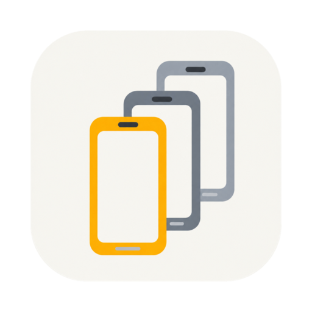
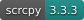

<div align="center">



# Multi Session Device

**Manage Android devices, interact with their screens, and capture test evidence in one workspace.**

A desktop tool for software testers · Isolated emulators · USB / wireless devices

[简体中文](README.md) · [繁體中文](README.zh-TW.md) · [English](README.en.md)

[](https://developer.android.com/)
[](https://github.com/Genymobile/scrcpy)


[Features](#features) · [Platforms](#platforms-and-project-status) · [Getting started](#getting-started) · [Development](#local-development)

</div>

---

Test multiple accounts, reproduce issues across Android versions, connect a physical device, and collect logs and screenshots for a bug report. Multi Session Device brings these tasks into a desktop window: manage devices on the left, interact with the selected screen on the right, and open logs and testing tools as needed.

Each emulator has its own Android Virtual Device (AVD). Prepare an SDK, select a system image, and create devices from the app, or reuse an existing Android Studio SDK.

## Features

| Capability                       | What you can do                                                                                                                        |
| -------------------------------- | -------------------------------------------------------------------------------------------------------------------------------------- |
| **Isolated emulators**           | Select hardware profiles and system images; configure, create, start, stop, rename, and delete AVDs                                    |
| **Physical devices**             | Connect Android devices over USB or wireless ADB, with connection status and authorization guidance                                    |
| **Screen mirroring and control** | Use mouse gestures, two-finger input, keyboard and Chinese text input, navigation, volume, and rotation controls                       |
| **Screenshots and annotations**  | Copy screenshots, save PNGs, and annotate, pixelate, or crop them in a separate editor window                                          |
| **Screen recording**             | Record MP4, pause and resume, and capture device audio; see the compatibility and validation limits below                              |
| **Live logs**                    | View Logcat, filter by keyword, pause and resume, or open a separate log window                                                        |
| **Testing tools**                | Drag and drop APKs to install, sync plain-text clipboards in both directions, and toggle airplane mode, Wi-Fi, and mobile data         |
| **Workspace settings**           | Switch and migrate SDK sources, use device skins and appearance themes, and choose Simplified Chinese, Traditional Chinese, or English |

## Platforms and project status

The project is under active development, with a current focus on source builds and local validation.

| Host platform                   | Current scope                                                                                                                             |
| ------------------------------- | ----------------------------------------------------------------------------------------------------------------------------------------- |
| **macOS · Apple Silicon**       | Core emulator and mirroring workflows validated with arm64 system images                                                                  |
| **Windows · x64**               | SDK setup, x86_64 image handling, process and file operations, and window adaptations implemented; some integration checks remain pending |
| **Linux / other architectures** | Support and validation are incomplete; packaging configuration alone does not establish support                                           |

- The current target is **Android**. iOS support is not implemented.
- The full Windows test suite still has existing failures involving platform paths, permissions, and fixture assumptions. Tests do not pass on all platforms.
- Long recording audio/video synchronization, audio on some physical devices, and interaction performance still need complete validation.

## Getting started

### Run from source

Install **Node.js 22** and **npm**, then run these commands from the repository root:

```bash
npm install
npm run dev
```

### Create your first emulator

1. Open the app and follow Android SDK setup, or select an existing SDK source in settings.
2. Choose a hardware profile and a system image compatible with your host, download the image, and create an AVD.
3. Start the device from the left sidebar and wait for its screen to become available.
4. Open Logcat, the screenshot editor, or recording tools as needed.

SDK sources include app-managed storage, a custom directory, and a shared Android Studio SDK. Managed data defaults to the application data directory. SDK and system image downloads require internet access; images and running devices consume disk space and memory.

### Connect a physical device

- **USB:** Enable developer options and USB debugging, connect your device, and approve debugging authorization on the device.
- **Wireless:** Open the connection window from the physical-device section and use discovery, a manual address, or pairing codes where supported.
- Select a connected device from the list to mirror and control it. Android versions and manufacturer restrictions can affect discovery, audio, and some controls.

## Local development

```bash
# Checks before committing
npm run typecheck
npm run lint
npm test

# Build main, preload, and renderer processes, including type checks
npm run build
```

Package on the corresponding host platform:

```bash
# macOS
npm run build:mac

# Windows
npm run build:win
```

Build output goes to `out/`; packaged artifacts go to `dist/`. macOS notarization is currently disabled. A local build is not a signed, notarized production release. Dependency mirror settings are in [`.npmrc`](.npmrc).

### Project structure

```text
src/
├── main/       # Electron main: devices, SDK, windows, media, and IPC
├── preload/    # Controlled window.api bridge
├── renderer/   # React UI and device screen canvas
└── shared/     # Types, IPC channels, localization, and shared contracts
resources/      # scrcpy server and static assets
build/          # Platform icons and packaging resources
scripts/        # Build, validation, and maintenance tools
```

The main process owns device and application state. The preload bridge exposes an allowlisted API, and the renderer handles UI and input. Mirroring uses scrcpy / Tango and WebCodecs, screenshot editing uses Konva, and recording uses Mediabunny for media muxing.

## Feedback and contributions

For bug reports, include your host OS and architecture, app version, Android version, emulator or physical-device connection method, reproduction steps, and relevant logs. Remove accounts, device identifiers, and other personal information from screenshots and logs before sharing.

For feature requests, describe the testing scenario. Run type checks, lint, and relevant tests before submitting code. When changing localized UI text, check all three language versions.

## Acknowledgments

- [BoCode](https://github.com/Focus695/BoCode/) — Development workflows, documentation templates, and knowledge base maintenance scripts.
- [scrcpy](https://github.com/Genymobile/scrcpy) / [Tango](https://github.com/yume-chan/ya-webadb) — Android communication and mirroring foundations.
- [Electron](https://github.com/electron/electron) / [electron-vite](https://github.com/alex8088/electron-vite) — Desktop runtime and build tooling.
- [React](https://github.com/facebook/react) / [Konva](https://github.com/konvajs/konva) / [Mediabunny](https://github.com/Vanilagy/mediabunny) — UI, screenshot editing, and media processing.

Third-party components and assets remain subject to their respective licenses.
