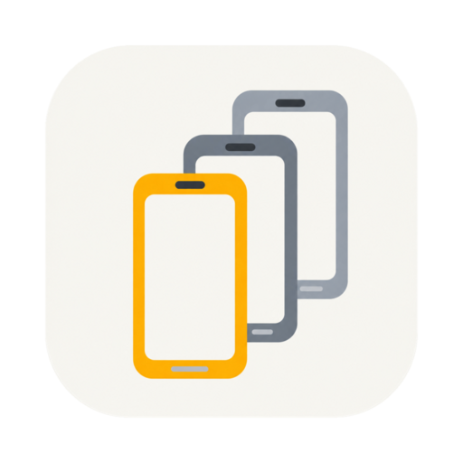
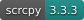
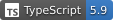

<div align="center">



# Multi Session Device

**把 Android 设备管理、操作与测试取证，放进同一个工作台。**

面向软件测试人员的桌面工具 · 独立模拟器 · USB / 无线真机

[简体中文](README.md) · [繁體中文](README.zh-TW.md) · [English](README.en.md)

[](https://developer.android.com/)
[](https://github.com/Genymobile/scrcpy)




[功能](#功能) · [平台](#平台与当前状态) · [开始使用](#开始使用) · [本地开发](#本地开发)

</div>

---

测试多个账号、复现系统版本差异、连接手边的真机，再把日志和截图带回缺陷报告。Multi Session Device 将这些日常操作集中在一个桌面窗口：左侧管理设备，右侧直接操作，按需展开日志和测试工具。

每台模拟器拥有独立的 Android Virtual Device（AVD）。你可以在应用内准备 SDK、选择系统镜像并创建设备，也可以使用已有的 Android Studio SDK。

## 功能

| 能力           | 可以做什么                                                                 |
| -------------- | -------------------------------------------------------------------------- |
| **独立模拟器** | 选择设备画像与系统镜像，配置、创建、启动、停止、重命名和删除 AVD           |
| **真机接入**   | 通过 USB 或无线 ADB 连接 Android 设备，查看连接状态与授权提示              |
| **投屏与操控** | 鼠标触控、滑动、双指操作、键盘与中文输入，以及导航、音量和旋转             |
| **截图与标注** | 截图到剪贴板、保存 PNG，在独立编辑窗中添加标注、马赛克和裁剪               |
| **录屏**       | 录制 MP4，暂停与继续，支持设备音频采集；兼容性与验收边界见下文             |
| **实时日志**   | Logcat 面板、关键字过滤、暂停与继续，也可弹出独立日志窗口                  |
| **测试辅助**   | 拖拽安装 APK、双向纯文本剪贴板同步，以及飞行模式 / Wi-Fi / 移动数据开关    |
| **工作环境**   | SDK 来源切换与迁移、设备皮肤、外观主题，以及简体中文 / 繁体中文 / 英文界面 |

## 平台与当前状态

项目仍在持续开发，当前以源码构建和本地验证为主。

| 宿主平台                  | 当前范围                                                                         |
| ------------------------- | -------------------------------------------------------------------------------- |
| **macOS · Apple Silicon** | 已验证基础模拟器与投屏链路，使用 arm64 系统镜像                                  |
| **Windows · x64**         | 已实现 SDK 引导、x86_64 镜像适配、进程与文件处理、窗口适配；部分集成验收仍待补齐 |
| **Linux / 其他架构**      | 尚未完成支持与验收；存在打包配置不代表可用                                       |

- 当前面向 **Android**；iOS 尚未实现。
- Windows 全量测试仍有平台路径、权限与夹具假设相关的既有失败，不能据此宣称全平台测试通过。
- 录屏的长时间音画同步、部分真机音频和交互性能仍待完整验收。

## 开始使用

### 从源码运行

准备 **Node.js 22** 和 **npm**，在仓库根目录执行：

```bash
npm install
npm run dev
```

### 创建第一台模拟器

1. 打开应用，按引导准备 Android SDK，或在设置中选择已有的 SDK 来源。
2. 选择设备画像和与宿主兼容的系统镜像，完成下载并创建 AVD。
3. 从左侧列表启动设备，等待画面就绪后直接操作。
4. 按需打开 Logcat、截图编辑器或录屏工具。

SDK 支持应用托管、自选目录及共享 Android Studio SDK；托管数据默认位于应用数据目录。SDK 和系统镜像下载需要网络，镜像与多台运行设备会占用磁盘和内存。

### 连接真机

- **USB**：开启开发者选项与 USB 调试，连接电脑，并在设备上确认调试授权。
- **无线**：从真机分区打开连接窗口，使用扫描、手动地址或设备支持的配对码流程。
- 连接后从列表选择设备，即可投屏和操作。设备系统与厂商限制可能影响无线发现、音频和部分控制功能。

## 本地开发

```bash
# 提交前检查
npm run typecheck
npm run lint
npm test

# 构建主进程、预加载桥与渲染进程（含类型检查）
npm run build
```

打包请在对应宿主平台执行：

```bash
# macOS
npm run build:mac

# Windows
npm run build:win
```

构建输出位于 `out/`，打包产物位于 `dist/`。macOS 当前配置未启用公证；本地构建不等同于已签名、公证的正式发行版。依赖镜像配置见 [`.npmrc`](.npmrc)。

### 项目结构

```text
src/
├── main/       # Electron 主进程：设备、SDK、窗口、媒体与 IPC
├── preload/    # 受控的 window.api 桥
├── renderer/   # React 界面与投屏画布
└── shared/     # 类型、IPC 通道、国际化与共享契约
resources/      # scrcpy server 与静态资源
build/          # 平台图标与打包资源
scripts/        # 构建、校验与维护工具
```

主进程管理设备与应用状态，预加载桥只开放白名单 API，渲染进程负责界面与输入。投屏基于 scrcpy / Tango 与 WebCodecs，截图编辑使用 Konva，录屏封装使用 Mediabunny。

## 反馈与贡献

反馈问题时，请附上宿主系统与架构、应用版本、Android 版本、模拟器或真机连接方式、复现步骤与相关日志。截图和日志请先移除账号、设备标识及其他私人信息。

功能建议请描述具体测试场景；提交代码前运行类型检查、lint 和相关测试。界面文案涉及三语时，请同步检查三个语言版本。

## 致谢

- [scrcpy](https://github.com/Genymobile/scrcpy) / [Tango](https://github.com/yume-chan/ya-webadb) — Android 通信与投屏基础。
- [Electron](https://github.com/electron/electron) / [electron-vite](https://github.com/alex8088/electron-vite) — 桌面运行环境与构建工具。
- [React](https://github.com/facebook/react) / [Konva](https://github.com/konvajs/konva) / [Mediabunny](https://github.com/Vanilagy/mediabunny) — 界面、截图编辑与媒体处理。

第三方组件与资源遵循各自的许可证。
