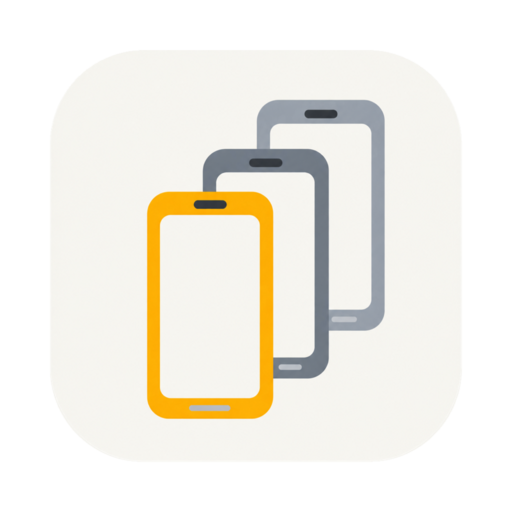
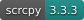

<div align="center">



# Multi Session Device

**在同一個工作台管理 Android 裝置、操作畫面並蒐集測試證據。**

為軟體測試人員打造的桌面工具 · 獨立模擬器 · USB / 無線實體裝置

[简体中文](README.md) · [繁體中文](README.zh-TW.md) · [English](README.en.md)

[](https://developer.android.com/)
[](https://github.com/Genymobile/scrcpy)


[功能](#功能) · [平台](#平台與目前狀態) · [開始使用](#開始使用) · [本機開發](#本機開發)

</div>

---

測試多個帳號、重現不同系統版本的問題、連接手邊的實體裝置，再把日誌與截圖帶回問題報告。Multi Session Device 將這些日常操作整合在同一個桌面視窗：左側管理裝置，右側直接操作，依需要展開日誌與測試工具。

每台模擬器都有獨立的 Android Virtual Device（AVD）。你可以在應用程式內準備 SDK、選擇系統映像檔並建立裝置，也能使用現有的 Android Studio SDK。

## 功能

| 能力               | 可以做什麼                                                                 |
| ------------------ | -------------------------------------------------------------------------- |
| **獨立模擬器**     | 選擇裝置設定檔與系統映像檔，設定、建立、啟動、停止、重新命名及刪除 AVD     |
| **實體裝置連線**   | 透過 USB 或無線 ADB 連接 Android 裝置，查看連線狀態與授權提示              |
| **畫面鏡像與操作** | 滑鼠觸控、滑動、雙指操作、鍵盤與中文輸入，以及導覽、音量與旋轉             |
| **截圖與標註**     | 將截圖複製到剪貼簿、儲存 PNG，在獨立編輯視窗加入標註、馬賽克與裁切         |
| **螢幕錄影**       | 錄製 MP4，暫停與繼續，支援擷取裝置音訊；相容性與驗收範圍見下文             |
| **即時日誌**       | Logcat 面板、關鍵字篩選、暫停與繼續，也能開啟獨立日誌視窗                  |
| **測試輔助**       | 拖放安裝 APK、雙向純文字剪貼簿同步，以及飛航模式 / Wi-Fi / 行動數據開關    |
| **工作環境**       | SDK 來源切換與遷移、裝置外觀、佈景主題，以及簡體中文 / 繁體中文 / 英文介面 |

## 平台與目前狀態

專案仍持續開發，目前以原始碼建置與本機驗證為主。

| 主機平台                  | 目前範圍                                                                           |
| ------------------------- | ---------------------------------------------------------------------------------- |
| **macOS · Apple Silicon** | 已驗證基本模擬器與畫面鏡像流程，使用 arm64 系統映像檔                              |
| **Windows · x64**         | 已實作 SDK 引導、x86_64 映像檔適配、程序與檔案處理、視窗適配；部分整合驗收仍待補齊 |
| **Linux / 其他架構**      | 尚未完成支援與驗收；有打包設定不代表可用                                           |

- 目前支援對象為 **Android**；尚未實作 iOS。
- Windows 完整測試仍有平台路徑、權限與測試資料假設造成的既有失敗，不能宣稱所有平台的測試均已通過。
- 螢幕錄影的長時間影音同步、部分實體裝置音訊與操作效能仍待完整驗收。

## 開始使用

### 從原始碼執行

準備 **Node.js 22** 與 **npm**，在儲存庫根目錄執行：

```bash
npm install
npm run dev
```

### 建立第一台模擬器

1. 開啟應用程式，依引導準備 Android SDK，或在設定中選擇現有 SDK 來源。
2. 選擇裝置設定檔及與主機相容的系統映像檔，完成下載並建立 AVD。
3. 從左側清單啟動裝置，等待畫面就緒後直接操作。
4. 依需要開啟 Logcat、截圖編輯器或螢幕錄影工具。

SDK 支援應用程式管理、自選目錄與共用 Android Studio SDK；受管理的資料預設儲存在應用程式資料目錄。下載 SDK 與系統映像檔需要網路，映像檔與多台執行中的裝置會占用磁碟及記憶體。

### 連接實體裝置

- **USB**：開啟開發人員選項與 USB 偵錯，連接電腦，並在裝置上確認偵錯授權。
- **無線**：從實體裝置區域開啟連線視窗，使用掃描、手動位址或裝置支援的配對碼流程。
- 連線後從清單選擇裝置，即可顯示畫面並操作。裝置系統與廠商限制可能影響無線探索、音訊及部分控制功能。

## 本機開發

```bash
# 提交前檢查
npm run typecheck
npm run lint
npm test

# 建置主程序、預載橋接與渲染程序（含型別檢查）
npm run build
```

請在對應的主機平台打包：

```bash
# macOS
npm run build:mac

# Windows
npm run build:win
```

建置輸出位於 `out/`，打包產物位於 `dist/`。macOS 目前未啟用公證；本機建置不等於已簽署並完成公證的正式發行版。套件鏡像設定見 [`.npmrc`](.npmrc)。

### 專案結構

```text
src/
├── main/       # Electron 主程序：裝置、SDK、視窗、媒體與 IPC
├── preload/    # 受控的 window.api 橋接
├── renderer/   # React 介面與畫面畫布
└── shared/     # 型別、IPC 通道、國際化與共用契約
resources/      # scrcpy server 與靜態資源
build/          # 平台圖示與打包資源
scripts/        # 建置、檢查與維護工具
```

主程序管理裝置與應用程式狀態，預載橋接僅開放白名單 API，渲染程序負責介面與輸入。畫面鏡像採用 scrcpy / Tango 與 WebCodecs，截圖編輯使用 Konva，錄影封裝使用 Mediabunny。

## 回報與貢獻

回報問題時，請附上主機系統與架構、應用程式版本、Android 版本、模擬器或實體裝置的連線方式、重現步驟及相關日誌。分享截圖與日誌前，請移除帳號、裝置識別資訊及其他私人資料。

功能建議請描述具體測試情境；提交程式碼前執行型別檢查、lint 與相關測試。介面文案涉及三種語言時，請同步檢查所有語言版本。

## 致謝

- [BoCode](https://github.com/Focus695/BoCode/) — 開發工作流程、文件範本與知識庫維護腳本。
- [scrcpy](https://github.com/Genymobile/scrcpy) / [Tango](https://github.com/yume-chan/ya-webadb) — Android 通訊與畫面鏡像基礎。
- [Electron](https://github.com/electron/electron) / [electron-vite](https://github.com/alex8088/electron-vite) — 桌面執行環境與建置工具。
- [React](https://github.com/facebook/react) / [Konva](https://github.com/konvajs/konva) / [Mediabunny](https://github.com/Vanilagy/mediabunny) — 介面、截圖編輯與媒體處理。

第三方元件與資源依循各自的授權條款。
