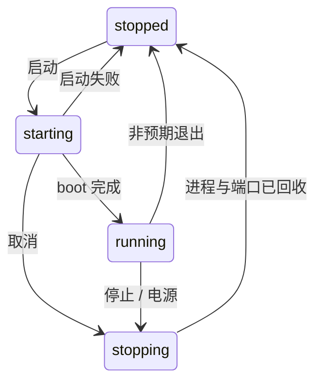

# Android 运行与操控

源码依据为 feature/stage04-emulator-integration 的 `3c3ea2a`，本次 squash 合入 dev。基础链路在 macOS Apple Silicon + arm64 镜像验收；[阶段 4](../../stage/04-模拟器对接.md) 五个正式步骤完成。向导扩展的完整验收继续按 [原 plan](../../plans/2026-10-05-emulator-wizard.md) 跟踪，阶段收尾不代替其未完成的判据。

## 模块与数据流

| 模块                                                 | 职责                                                              |
| ---------------------------------------------------- | ----------------------------------------------------------------- |
| `src/main/emulator/`                                 | SDK/镜像检测下载、画像与能力、AVD 配置、皮肤/摄像头、端口和进程池 |
| `src/main/devices/index.ts`、`store.ts`              | 生命周期编排、代次与快照、元数据原子写入                          |
| `src/main/scrcpy/`                                   | scrcpy-server 3.3.3、adb forward、视频与控制连接、输入注入        |
| `src/preload/api/`、`src/shared/`                    | 白名单 window.api、类型与通道名单源；main 验证 sender 与入参      |
| `DeviceWizard`、`DeviceCanvas`、`screen/geometry.ts` | 两页向导、WebCodecs 画布、外框与输入共用几何                      |

renderer 经 preload 发命令；main 保存真实状态并推送带 revision 的 DeviceSnapshot。视频由 main 经 webContents.send 送 renderer；输入反向走受控 IPC。后台保留连接并暂停解码，左侧列表是设备切换入口。

## 数据与隔离

应用 userData（macOS 默认 `~/Library/Application Support/multi-session-device/`）下：

| 路径                               | 内容                                                         |
| ---------------------------------- | ------------------------------------------------------------ |
| `AndroidSDK/`                      | 应用 SDK 与按需下载的镜像                                    |
| `avd-home/<id>.avd/` 与 `<id>.ini` | 每台设备独立 AVD；设备 id 也是 AVD 名                        |
| `devices.json`                     | v2 元数据，兼容读取 v1；运行态、serial、进程和运行错误不入盘 |
| `device-skins/`                    | 导入和官方获取的皮肤资源                                     |
| `theme.json`                       | 主进程持久化的主题选择                                       |

子进程注入应用自有 ANDROID_AVD_HOME，不纳管 Studio 的 AVD。运行总线共享本机 adb 5037；优先选择用户已有 adb，相容则复用，不相容拒绝，不 kill-server。启动前端口分配同时避让预留、TCP 占用与已登记 serial。

emulator 的 console token 路径不能靠 ANDROID_EMULATOR_HOME 隔离；runner 不使用 console 停机，改为终止自己创建的进程组。技术边界见 [实测 issue](../../notes/issue/2026-10/2026-10-05-console-token-escapes-avd-isolation.md)。元数据/目录对账已于 2026-10-08 落地（[plan](../../plans/2026-10-05-avd-reconciliation.md)）：首载与人工重查做只读核验，availability/storeHealth 随快照发布（missing/broken/inaccessible/unsafe 归因、坏库冻结写入、孤立组只列不清理）；真正启动前经 runner 的 beforeStart 即时核验文件与摄像头，可取消、超时不放行。

## 启停与输入契约

`window.api.devices` 提供 list/create/rename/remove/start/stop/cancelStart/copySerial 和快照、运行错误订阅；监听返回解绑函数。start 等待准备接纳后返回，不等待整个 boot；完成由 changed 推送。主进程持有 runId，迟到回调不能覆盖新启动。

准备任务在首次 await 前登记，取消和退出也能中止 ADB/端口等待并释放预留。取消只撤销本次任务，底层共享 ADB 准备可能继续完成；其迟到结果不会 spawn。版本探测持续拼完整帧，end/close/error 或连接前开始的 3 秒总期限均结束等待。

电源按钮复用停止链路，完成后右侧显示停止占位，重新运行从左侧启动。手动旋转先释放旧触点/按键、锁定设备自动旋转，再旋转；旋转期间合法的新输入直接丢弃，不排队、不补发。renderer 同时取消移动 RAF，丢弃跨暂停 IME。输入还需通过设备、runId、订阅 token、画面 generation 与尺寸守卫。

皮肤按精确画像匹配固定官方源并核验缓存；实际位图和输入共用屏幕矩形。当前按用户约定允许圆角/挖孔前景遮挡。坏资源或比例不匹配会诊断并回退通用外框。摄像头兼容新旧枚举，配置保存 webcamN 与稳定宿主身份，创建/启动重新核验；macOS 权限入口由本应用请求，正式签名版取景责任链仍待实测。

## 操作与排查

1. `npm install`、`npm run dev` 启动；在新建设备向导检测/引导 SDK，选择画像、兼容镜像和设置后创建。
2. 左侧启动，等待 boot 与投屏；准备期间可取消。工具条电源或左侧停止用于关机，删除需确认。
3. 无法启动先读设备行错误，核对该 id 的 AVD 目录及配置、SDK 可执行文件、共享 adb 协议与 serial。只检查本次设备，不停止外部模拟器或共享服务。
4. 分段探测或取消问题可按 [受控复现附录](../../notes/issue/2026-10/2026-10-07-api32-start-repro-procedure.md) 对照；当前已修复，应正常解析或明确失败，结束诊断后移除临时注入。
5. 自动验证使用 `npm run build`（含 typecheck）、`npm run lint`、`npm test`；book 变动后生成索引并跑 release-check。

2026-10-08 合并检查：全量 443 项通过、5 项既有跳过，构建/typecheck/lint 通过。2026-10-08 对账轮（feat/avd-reconciliation）：全量 502 项通过、5 项既有跳过，构建/typecheck/lint 通过。真实设备历史证据见阶段步骤、[投屏 plan](../../plans/2026-10-05-device-stream-control.md) 和 [启动修复报告](../../notes/issue/2026-10/2026-10-07-api32-start-smoke-blocked.md)；除合并轮外均未重跑这些设备场景。全仓 src 格式仍有 [既有 fixture README 问题](../../notes/issue/2026-10/2026-10-07-fixture-readme-format-baseline.md)。

## 未完成范围

Quick Boot 连续/双机稳定性门槛未过，选择器保持禁用；Android 摄像头取景、签名版权限、能力时延六次测量、解压瞬间取消和六类完整验收仍按 [验收 plan](../../plans/2026-10-06-real-machine-verification.md) 跟踪。[向导遗留](../../notes/issue/2026-10/2026-10-06-wizard-plan-remaining-acceptance.md) 已更新当前状态；直连镜像 package.xml 的 P1 仍见 [验收发现](../../notes/issue/2026-10/2026-10-06-real-machine-acceptance-findings.md)。

日志、截屏/录屏、APK 安装、宿主与设备剪贴板、断网、设置窗和资源防线归 [阶段 5](../../stage/05-功能完善.md)。iOS、跨架构和 Windows/Linux 不属于当前已验平台。
