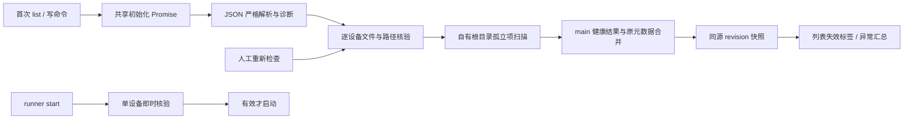

	
# 持久化对账 — plan

> [stage04](../stage/04-模拟器对接.md) 本项仍为 `[suggested]`。用户本次要求对剩余三项进行 brief、分析与设计，因此可以完成这份草案；没有将建议转正、没有授权实现，也没有进行目录修复或清理。本文仅覆盖 Step 0、Phase 1、Phase 2。

## Requirements brief（Step 0）

### Background

[PRD 4.2](../docs/PRD.md) 规定 JSON 只存名称/创建参数等元数据，AVD 目录是模拟器数据事实源；元数据有而目录无时标记失效并提示，禁止静默清理。stage03 遗留 mock 行、外部删改以及创建/删除部分失败都可能使两者不一致。需在首次列表发布前核验，保留证据并阻止错误启动。

### Scope

- **Affects**：main/store 提供可区分的读取诊断；emulator 增纯检查/对账；devices 首载、刷新与启动前检查接入；shared/preload 增 availability/report；列表及画布显示失效与重试。
- **Does NOT affect**：AVD 自动重建、自动清理、迁移、导入/纳管、克隆、擦除、镜像下载、SDK 路径设置、磁盘配额、持续文件 watcher；不扫描用户 Android Studio 的 AVD，不按目录重写画像/API/name，不把孤立目录直接补成设备；不根据磁盘缺失停止已运行 emulator。
- **Boundaries**：只读应用自有 `devices.json` 和 `avd-home` 的受控路径；id=AVD 名约定沿现有 UUID 设备；检查结果只在主进程内存，JSON v1 不增加运行态或有效性字段。刷新只改变健康信息，不能排序、重命名或删除设备。

### Requirement

1. 启动首次加载完成 JSON 解析和目录核验，再发布第一份列表快照；多个并发 list/create/start 共用同一初始化 Promise。
2. 元数据有，但 `.ini`、`.avd` 或 `config.ini` 缺失时保留设备行，标「失效」并说明缺哪项；启动禁用，名称和顺序不变。
3. 文件存在但结构损坏、目录不可读或路径越界分别标明原因；权限错误/超时不能被解释为「设备已删除」。检查未知时不允许启动。
4. 元数据不存在但 AVD 文件存在时记为孤立文件组，保留原文件，不自动纳管或删除。仅 `.ini` 或仅 `.avd` 也进入报告。
5. 提供「重新检查」：文件恢复后在同一设备 id 上回到有效，保留选中态；结果有变化才推送与提示。每次真正启动前再核验该设备，防止首次检查后目录被删。
6. 用户明确确认删除失效设备时，可移除该 id 元数据并删除应用根内仍存在的预期文件；不得跟随 `.ini` 的外部 path 删除。不自动重建任何数据。

### 补充设计轴

以下为 `[recommended — confirm or reject]`：

| 设计轴       | 推荐                                                                                                |
| ------------ | --------------------------------------------------------------------------------------------------- |
| 错误数据保护 | JSON 读取错误、损坏、未知版本或坏条目时保留原文件并冻结元数据写入，避免后续 create 把原库覆盖成空库 |
| 幂等、竞态   | 首载一次 Promise；刷新单飞；与元数据提交串行，检查结果仅在相同 revision/runId 上合并                |
| 缓存失效     | 启动首载、人工刷新、create/delete 结果及启动前触发；不用长期缓存存在性，也不引 watcher              |
| 通知         | 有异常时首窗就绪后一次汇总原生 dialog；列表持续显示健康原因；刷新不变不重弹，不用系统通知           |
| 权限/路径    | 校验 id、文件类型、canonical containment；拒绝根外路径与逃逸 symlink，原路径只用于诊断              |
| 事务/迁移    | 对账不改 JSON、不补默认参数；旧 mock 行标失效；文件部分成功只显示实际结果，不据此宣称事务已修复     |

## Impact range（Phase 1）

### 当前调用链与差距

`devices.ensureLoaded → readDeviceMetas → metas.map(status=stopped)` 完全不访问 AVD。`readDeviceMetas` 对不存在、EACCES、坏 JSON 均返回空数组；条目守卫不查 id 格式和重复，坏条目被过滤，version 未校验。因此 renderer 的空库显示不能区分首次启动与读库失败。

`avdExists` 只读 `.ini`，任意读错误都返回 false；有 `.ini` 但 `.avd/config.ini` 已缺也算存在。它适用于早期创建防重复，不能作为对账的判据。`deleteAvd` 只删按 id 推导的两条路径，不读取 `.ini` 外部 path；此删除范围继续保留。

### 风险与处理

| 风险                                     | 设计处理                                                                            |
| ---------------------------------------- | ----------------------------------------------------------------------------------- |
| EACCES 被空库掩盖，后续写盘覆盖原库      | typed store 读取结果；失败不进入空库写流程；只有 ENOENT 是正常首次启动              |
| JSON 有名字就当 AVD 有效                 | 同时查 `.ini`、目录、config 和关键路径；不只复用 avdExists 的布尔                   |
| `.ini` 指向根外或 symlink 逃逸           | 校验预期路径和 realpath；unsafe 行不能启动，删除只可处理自有根内安全项              |
| 配置/系统镜像不一致                      | 显示真实文件诊断；镜像缺失单独归因，不能自动改元数据或下载镜像                      |
| 刷新期间 create/delete，旧结果覆盖新状态 | 与元数据提交串行；检查捕获 revision，必要时重查目标，再按当前 runId 合并            |
| JSON 部分坏条目被静默抛弃                | 报告条目索引与错误，不伪造可操作设备；原文件保留，元数据写入冻结                    |
| 正在运行的 AVD 文件被外部删除            | 健康态与运行态分离；停止仍可用；不报 stopped、不杀进程、不删剩余文件                |
| 单次检查后又被外部删除                   | runner 启动前复查；spawn 后外部改动仍由 runner 错误路径处理，无法用扫描保证全程原子 |

已记录的 [首载竞态](../notes/issue/2026-10/2026-10-03-devices-ensure-loaded-concurrent-double-read.md) 与 [落盘分叉](../notes/issue/2026-10/2026-10-03-devices-persist-failure-divergence.md) 继续引用。对账只暴露文件侧后果，不把修复存储事务或自动恢复残留进程夹入本步。

## Design（Phase 2）

### 数据契约

沿用 [runner 草案](2026-10-05-emulator-runner.md) 的 `DeviceSnapshot/revision`，扩展：

- `Device.availability = { state: 'valid'|'missing'|'broken'|'inaccessible'|'unsafe', reasonCode?, message?, checkedAt }`。初始化完成后必须有检查结果；步骤 6 未实施时不强制整个 IPC 提前依赖此字段。
- `ReconcileReport = { checkedAt, storeHealth, deviceIssues, orphanEntries, scanError? }`；issues 按 id 或元数据原条目索引定位，不记录用户内容、登录信息或整个原始 JSON。
- `storeHealth = { state: 'ok'|'read-only'|'error', issues: { code, entryIndex?, message }[] }`。缺文件等价正常空库；结构完整且 v1 的文件为 ok；可读取但有坏条目/重复 id 时 read-only；损坏、未知版本、权限或 IO 失败为 error。
- snapshot 增 storeHealth 及可选对账报告摘要；详细 report 经专用 invoke 拉取。错误原文件不被自动改写；availability/report 不写盘。

read-only 时，合法且 id 唯一的条目仍可展示，启动要通过单设备检查；不合法/重复 id 的条目只在诊断中出现，不任取一条作为可操作设备。create/rename/delete 等所有元数据写入拒绝并说明修复文件后重新检查。error 时不返回假成功空库，list 回传带错误健康态的快照，界面显示「设备数据读取失败」；runtime registry 若已存在仍保留，停止入口不依赖库可写。

### 只读核验步骤

1. 解析 store：仅 ENOENT 视为空库；校验顶层 `{ version: 1, devices: [...] }`、原有字段、非空名称、有限数值和 UUID id；坏条目逐项诊断，禁止路径字符串进入 FS 拼接。接受当前应用生成的 UUID，遇到未知旧格式给出不兼容诊断，不静默迁移。
2. 受控扫描 `avd-home` 顶层：根 ENOENT 且无设备是正常首次使用；根缺失但有设备则各行 missing；EACCES/其他 IO 错误返回 scanError/inaccessible，不能构造「全部已删」结果。每设备检查建议最多 4 路并发，防止大目录抢占 UI；不递归读取数据盘内容。
3. 对每 id 用 `avdPaths` 推导两条路径；lstat 检查 `.ini` 为正常文件、`.avd` 为目录、`config.ini` 为正常文件。路径需落自有根内；禁止 symlink 跳至根外，config/ini symlink 作为 unsafe，避免随后启动时追随路径。
4. 解析 `.ini/config.ini` 的最小 key=value：忽略注释/空行；关键键重复、非法格式、`.ini.path` 缺失或不等于预期 canonical `.avd` 为 broken/unsafe。合法 `.ini.path.rel` 可以存在，但不得覆盖已验证绝对 path。`image.sysdir.1` 的相对值从当前 SDK 根解析，绝对值也必须落该根内；读不到镜像按具体 ENOENT/权限归因。读取范围设有界上限（建议单配置 64KiB），不载入 userdata 镜像。
5. 有效判据：三个主体存在且可读、路径安全、config 有可解析的镜像/ABI/分辨率关键项、对应 SDK 镜像可读取；不把 config 与元数据逐字段一致强制成有效条件，不修改设备定义。SDK 根整体不可用时汇总环境错误，各行禁止启动；不是外部删除 AVD 的证据。
6. 目录按 `<id>.ini`/`<id>.avd` 组合同名扫描项，再与合法元数据 id 集合比较。无 meta 的组记 orphanEntries；未知文件名仅报告 ignored/unrecognized 数量，保留所有文件。首次 create 中的临时文件排除在本轮快照外；本工具持有的 transient id 从孤立判断中扣除。
7. 合并结果只更新健康字段与 report，不覆盖 runtime status/serial、名称或选中态；由 devices 唯一写入口递增 revision。刷新后如状态完全相同，不广播重复错误。

若读取超时，以 inaccessible/check-timeout 返回并丢弃迟到检查结果；不能超时后标 missing。文件检查和真正启动间仍有外部竞态，runner 必须用当前结果和 spawn 错误兜底。

### 与 runner、创建/删除的边界

runner 步骤 4 自带最小目标核验，因此可以先独立实现步骤 4/5。本步转正并实施后，把完整核验接入首次加载与 start preflight，不依赖 renderer 的灰按钮保证安全。

初始化及刷新共享加载 Promise；元数据读/写提交串行，同设备 start/delete/refresh 通过设备编排校验状态，长 boot 不锁全局元数据。stop/cancel 总可打断，不排在全量扫描后。首载失败的 Promise 释放后允许人工重试；不能只设 loaded=true 永久吞掉错误。

create 成功为该 id 重查；create 回滚失败的孤立文件进入报告。delete 失败重查剩余文件；JSON 提交失败时保留原 meta 与实际 availability，并返回明确错误。metadata/AVD 两侧不一致不会被对账自动「纠正」。元数据写保护期间禁用删除失效记录，保持原文件证据。

对失效设备的删除仍沿 runner 的删除确认和停止保护：缺文件允许 force 删除自有剩余项，再提交 JSON。unsafe 若由 root 本身 symlink、权限或无法确认 containment 引起，拒绝 FS 删除并给出手动处理提示；若只是 `.ini` 内容外指而两个预期文件都在安全根内，只删这两个预期位置，绝不跟随外部 path。

### IPC、界面、权限与通知

- `devices.reconcile()` / `devices:reconcile` → `{ snapshot, report }`，无 renderer 路径参数；重复刷新共享 Promise。`devices.reconciliationReport()` / `devices:reconciliation-report` 返回最近报告。
- `devices:list/changed` 仍同源 revision 快照，所有监听返回解绑；人工重查后才可解除 store 写保护。
- 主窗展示「失效：AVD 目录缺失」「无法读取：权限不足」等中文原因；状态点仍反映真实运行态。停止设备启动禁用，右栏提供原因与重新检查；已运行设备即使健康有异常仍可停止。
- 列表上方紧凑异常提示含受影响设备/孤立组数量、重新检查与查看详情；原生 dialog 汇总具体 id/原因、自有路径和保留策略。孤立目录没有自动清理按钮，恢复、导入与维修 UI 不进入本步。
- 首次异常汇总等主窗 ready 后发送一次；按异常内容签名去重，人工刷新变化才重新提示。无异常不弹窗；没有主窗时存结果，下一次窗口 ready 展示。renderer API reject 仍经 toApiResult。
- 仅登记主窗能刷新/读取报告；向导不获得任意 FS 检查能力，create 继续通过设备域初始化与写保护。检查服务只接受 main 推导路径；无额外系统授权或通知权限。

### 文件改动清单

| 文件                                                                                                                           | 后续改动                                                                 |
| ------------------------------------------------------------------------------------------------------------------------------ | ------------------------------------------------------------------------ |
| `src/main/store.ts`                                                                                                            | 新增读取结果与版本/坏条目/重复 id 诊断，保留原文件；devices 使用严格入口 |
| `src/main/emulator/reconcile.ts`                                                                                               | 新增只读核验、INI 解析、归类与孤立目录报告，可注入 FS 接缝               |
| `src/main/emulator/avd.ts`                                                                                                     | 安全路径和单目标核验接口共享，不能再用布尔吞 IO 错误                     |
| `src/main/devices/index.ts`、runner 接缝                                                                                       | 首载/刷新/提交合并、写保护、启动前复查、报告推送                         |
| `src/shared/{types,ipc-channels}.ts`、`src/preload/api/devices.ts`                                                             | availability、storeHealth、report 契约及白名单                           |
| `src/renderer/src/stores/deviceStore.ts`、`src/renderer/src/App.tsx`                                                           | 健康镜像、重新检查、异常汇总与读取失败态                                 |
| `src/renderer/src/components/{DeviceRow,CanvasPlaceholder,DeviceHealthNotice}.tsx`                                             | 失效原因、启动禁用、紧凑汇总提示；不改变排序                             |
| `src/main/{__tests__/store.test.ts,emulator/__tests__/reconcile.test.ts,devices/__tests__/index.test.ts}` 及 renderer 同级测试 | 临时根文件矩阵、读取诊断、并发与 UI 回归                                 |

## Build order（后续实现顺序，本次不执行）

1. 人确认 stage 建议步骤进入实现范围后再启动施工；保持本计划 draft 至该指令。
2. 定义 storeHealth/availability/report；以临时目录 fixture 覆盖完整、缺失、损坏、权限、symlink 和孤立组。
3. 解析 store 与写保护；验证损坏原文件字节不变、create/rename/delete 不覆盖它。
4. 接入共享初始化、刷新与 start preflight；用竞态测试验证不会覆盖正在运行状态或新创建设备。
5. 失效 UI 与汇总通知；人工移走/恢复自有临时 AVD、刷新恢复、确认删除缺失设备、孤立文件原样保留。
6. review 只记问题；实际完成后回写阶段状态，不自行移除 `[suggested]` 标记。

## Test plan（后续验证）

| 场景                                     | 预期                                                              |
| ---------------------------------------- | ----------------------------------------------------------------- |
| meta + 完整 AVD                          | valid；JSON 不变，可启动                                          |
| meta 存在，`.ini`/`.avd`/config 任一缺失 | missing；行保留、名称顺序不变、不能启动                           |
| AVD 无 meta，包括只有 ini/目录           | orphan；文件不变，不添加设备                                      |
| 文件恢复后重新检查                       | 同 id 回 valid、选中态不变，不重复弹旧异常                        |
| ini/config 损坏或关键字段重复            | broken；错误可解释，不自动重写                                    |
| EACCES/IO 超时                           | inaccessible；不是 missing，重试后可恢复                          |
| 路径外指/逃逸 symlink/id 注入            | unsafe 或条目诊断；无根外读取/删除/启动                           |
| SDK 镜像缺失与 SDK 根不可读              | 分开归因；不自动下载、不删 AVD                                    |
| JSON 不存在                              | 首次正常空库，可创建；不能等同其他读取错误                        |
| JSON 损坏/未知版本/部分坏行/重复 id      | 原文件字节不变，诊断可见，元数据写入拒绝                          |
| 同时 list/create/refresh/start/delete    | 一次首载、串行提交、旧检查不卷走新数据、cancel/stop 仍可及时打断  |
| 已运行设备被外部删文件                   | 运行态保留并显示健康异常，允许 stop，停止后不允许重新 start       |
| 用户确认删除失效设备                     | 仅安全自有剩余文件和该 meta 删除；原库写保护/路径不安全时明确拒绝 |

回归列表/向导/runner 状态、revision、错误反馈；相关及既有测试、typecheck/lint/build。真实 FS 验证只操作专用临时 AVD/目录，禁止拿用户默认 AVD 做破坏性案例；检查前后对比 JSON/孤立文件 hash，证明无隐式修改。

## Done criteria

本次完成条件是 Phase 2 草案完整、对账步骤仍 suggested、源码与 AVD 均未改。未来实现完成需矩阵验证通过、无静默清理/原文件覆盖/根外访问、review 问题在案；人主导 stage 的步骤转正，实际实现完成且验证后才可勾选；plan 才可 completed，索引重刷。

## 三步接口与实施依赖

| 归属          | 单源职责                                                                    | 相邻步骤如何使用                                                                |
| ------------- | --------------------------------------------------------------------------- | ------------------------------------------------------------------------------- |
| 步骤 4 runner | DeviceSnapshot/revision、runtime status、runId/serial、加载与元数据提交入口 | 步骤 5 订阅 running/stop，不自造状态；步骤 6 只合并 availability                |
| 步骤 5 投屏   | streamId/generation、活动 viewToken、解码与输入归属                         | 设备停止清流；目录异常不擅自停止 emulator 或已运行画面                          |
| 步骤 6 对账   | availability、storeHealth、只读文件报告                                     | start preflight 使用完整检查；write guard 约束元数据修改；stop 永远不依赖库可写 |

文档按 stage 原顺序为 4→5→6，不调整阶段步骤。实施时 4 的最小启动检查先挡住缺失 AVD；6 转正后再挂全量对账。两个现有核心 issue 的处理边界已写入各 plan，未在本会话修复。
