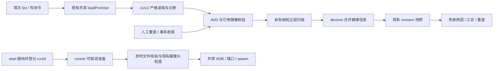

# 持久化对账 — plan

代码基线：`dev` 的 `a32374e`（2026-10-08）。[stage04](../notes/summary/2026-10/2026-10-09-模拟器对接.md) 五个正式步骤已完成。**2026-10-08 实现完成**：按用户指令在 `feat/avd-reconciliation` 分支落地本设计（typed store 读取、只读 AVD/镜像核验、首载/重查合并、runner beforeStart、IPC/UI/汇总提示），全量 502 项通过、typecheck/lint/build 通过；实现轮自查记录见 [issue](../notes/issue/2026-10/2026-10-08-avd-reconciliation-implementation-review.md)、测试经验见 [learn](../notes/learn/2026-10/2026-10-08-avd-reconciliation-implementation-notes.md)。当前运行契约见 [Android 运行快照](../docs/architecture/2026-10-08-android-runtime.md)。

## Requirements brief（Step 0）

### Background

[PRD 4.2](../docs/PRD.md) 规定 JSON 保存设备元数据，AVD 目录保存模拟器实际数据；记录存在但目录丢失时标记失效、提示用户，禁止静默清理。

现在已经有真实创建/删除、可取消 runner、投屏、精确镜像身份、附加设置、皮肤与摄像头。对账须接入这些现有链路，补齐重启、外部删改、创建回滚失败及删除部分失败后的诊断。首次加载互斥、元数据提交队列和部分 JSON 写保护均已实现，不再作为待建基础。

### Scope

- **Affects**：store 双版本读取诊断与写保护；应用自有 AVD/引用镜像的只读核验；devices 首载、重查、创建/删除结果和启动准备接入；shared/preload 健康契约；主窗失效展示、重新检查与异常汇总。
- **Does NOT affect**：自动重建/清理/导入/纳管 AVD、克隆、擦除、残留进程恢复、持续 watcher、下载镜像、SDK 路径设置、磁盘配额；不扫描 Android Studio 的 AVD；不修复向导的 Quick Boot 稳定性、摄像头取景或镜像 `package.xml` 兼容问题；不重做存储事务。
- **Boundaries**：路径由 main 从 `userData` 推导：`devices.json`、`avd-home`、`AndroidSDK`，皮肤路径校验还允许应用 `device-skins` 库。设备 id 继续作为 AVD 名。检查不写这些文件；availability/report 只在内存中，不升级 JSON schema。刷新保留现有设备名称、顺序与选中态，不根据文件异常停止正在运行的 emulator。

### Requirement

1. 首次加载在现有共享 Promise 内完成 JSON v1/v2 解析和文件核验，再发布列表；有效 v1 仍按现有规则派生 v2，读取与对账不触发迁移或备份。
2. `.ini`、`.avd` 或 `config.ini` 缺失时保留设备行，标明缺哪项并禁止启动。损坏、权限/IO 错误、超时和路径越界分别归因；未知检查结果不允许启动。
3. JSON 损坏、未知版本、坏条目、重复 id 或读取错误须可见，并冻结元数据写入。保护在 create/delete 的 AVD 副作用之前检查，不能只等最后写 JSON 时拒绝。
4. AVD 文件没有可信元数据时报告孤立组，包含仅 `.ini` 或仅 `.avd` 的情况；保留原文件，不自动添加设备。正在创建、删除或回滚的 id 暂不判孤立。
5. 人工「重新检查」可恢复文件健康状态；真正启动前即时核验，不信任上次扫描结果。重查无语义变化不重复广播或弹窗；启动检查可取消，迟到结果不覆盖新代次。
6. 用户确认删除失效设备后，沿用现有停止/取消与删除流程，仅删除安全应用根内的预期剩余文件和对应元数据；不跟随 `.ini` 外部 path，不自动恢复任何文件。
7. 健康态独立于运行态和 `lastError`。已运行设备即使文件异常仍保留画面与停止入口；store 不可写也不能阻止 stop/cancel/退出清理。

### 草案方案

| 设计轴   | 方案                                                                                                         |
| -------- | ------------------------------------------------------------------------------------------------------------ |
| 数据保护 | 沿用 v2 写入、v1 兼容派生和首次必要写入前的 `.v1-backup`；补齐严格诊断，不把坏条目过滤结果写回原库           |
| 并发     | 复用 `loadPromise`、`writeQueue`、删除单飞和 runner 代次；新增检查单飞与文件变更代次，不重建另一套设备状态机 |
| 触发     | 首载、人工重查、create/delete 收尾、start 准备；不引 watcher，不在设备切换时扫描                             |
| 提示     | 主窗列表持续显示原因，异常变化时一次汇总原生 dialog；不用系统通知                                            |
| 路径     | 校验 id、文件类型和 canonical containment；核验服务只接受 main 推导路径，拒绝受检路径的根外指向              |

## Impact range（Phase 1）

### 当前代码与剩余差距

以下是代码检查结果；表中测试路径表示已有回归锚，本次文档更新未重跑产品测试。

| 位置                                                               | 已实现                                                                                                                            | 对账仍需补齐                                                                                                            |
| ------------------------------------------------------------------ | --------------------------------------------------------------------------------------------------------------------------------- | ----------------------------------------------------------------------------------------------------------------------- |
| `src/main/store.ts`、`__tests__/store.test.ts`                     | 写 v2；显式读取 v1/v2；v1 派生精确 arm64 包名；坏 JSON、缺 devices 数组、未知版本置写保护；tmp+rename；一次性 v1 备份             | readFile catch 仍把所有 IO 错误当空库；坏条目直接过滤，无重复 id/完整设置校验；没有结构化健康结果和生产重查解除保护入口 |
| `src/main/devices/index.ts`、同级测试                              | `loadPromise` 共用首载，失败可重试；`commitMetas/writeQueue` 串行且写盘成功才重建内存；同源 revision 快照                         | 首载只读元数据并派生 frameKind，不查 AVD；提交重建须保留新增健康字段及完整运行字段                                      |
| `createDeviceTransaction`、`deleteFlow`                            | 官方 avdmanager 创建、config patch、v2 落盘；失败撤回临时行并回滚，回滚失败回报路径；删除先停、force 删除、同 id 单飞；失败保留行 | 副作用前检查库健康；事务结束核验实际文件；回滚残留进入报告，不宣称文件和 JSON 已原子提交                                |
| `startDevice`、`emulator/runner.ts`                                | 启动前 `avdExists`、webcam 身份重核验；runner 在首次 await 前登记准备，可取消 ADB/端口等待，runId 隔离迟到结果                    | `avdExists` 只读 `.ini`，吞所有读取错误；文件与摄像头检查目前在进入 starting/runner 准备之前，不能直接在这里增加长等待  |
| `emulator/catalog.ts`、`settings-contract.ts`                      | 精确 `imagePackageName` 含平台/tag/ABI；本地 package.xml、source.properties、system.img 安装判断；设置映射 config/argv            | 本地扫描吞单目录错误，不能区分缺镜像和读不了；对账需有诊断的单镜像检查，不拉远端 manifest                               |
| renderer 的 `deviceStore`、`DeviceRow`、`CanvasPlaceholder`、`App` | 忽略旧 revision，按 id 保持选中；真实状态和 lastError 展示；运行中挂 DeviceCanvas；原生确认/错误框                                | 没有 availability/storeHealth/report、失效启动守卫及重新检查；首次 list 失败只置 loaded，仍会显示普通空库               |

旧草案引用的 [首载双读](../notes/issue/2026-10/2026-10-03-devices-ensure-loaded-concurrent-double-read.md) 与 [落盘分叉](../notes/issue/2026-10/2026-10-03-devices-persist-failure-divergence.md) 已修复；现有测试覆盖并发 list 只读一次、删除文件后写盘失败保留行、队列失败后继续提交。本项复用这些实现。[读取错误问题](../notes/issue/2026-10/2026-10-05-device-store-read-error-as-empty.md) 只获部分保护，剩余读取、条目诊断和界面错误态仍归本设计。

### 数据流（拟实现）

### 风险与处理

| 风险                                                 | 设计处理                                                                                           |
| ---------------------------------------------------- | -------------------------------------------------------------------------------------------------- |
| 读取失败或坏条目被当空库/部分库，后续写入丢记录      | typed 读取结果；只把 ENOENT 当首次使用；坏数据冻结写入；create/delete 副作用前守卫                 |
| 用 `.ini` 可读推断有效，或用镜像空扫描推断已删除     | 检查三个 AVD 主体、配置路径及引用镜像；保留 errno，不复用布尔检查作为最终判据                      |
| 刷新重置 running、runId、serial 或启动检查无法取消   | 只合并健康字段；检查放进 runner 已登记准备；取消后的结果丢弃，stop/cancel 不排检查队列             |
| 扫描遇到 creating/deleting/回滚中的半成品            | 排除事务 id，捕获元数据/文件变更代次，变化后重查；正常 boot 状态变化不触发全量扫描重做             |
| 误把合法 v2/皮肤配置判坏，或把健康修复当资源验收通过 | 兼容现有可空字段、v1 派生、应用皮肤路径、config patch；不改设置、快照标记、摄像头策略或 Quick 门槛 |

## Design（Phase 2）

### 1. 数据契约与双版本读取

沿用已实现的 `DeviceMeta`、`Device`、`DeviceSnapshot`，拟新增：

- `Device.availability = { state: 'checking'|'valid'|'missing'|'broken'|'inaccessible'|'unsafe', issues: DeviceHealthIssue[], checkedAt: number|null }`。issue 带 `component: 'avd'|'image'`、code、message 和 `severity: 'error'|'warning'`；镜像缺失不能显示成 AVD 被删。creating 行及启动检查期间允许 checking；首份已加载快照中的稳定设备必须有检查结果。
- `StoreHealth = { state: 'ok'|'read-only'|'error', issues: { code, entryIndex?, message }[] }`。首载合法 v1/v2 或文件不存在为 ok；坏条目/重复 id，以及已加载库的外部元数据变化为 read-only；坏 JSON、非法顶层、未知版本、权限/IO 失败为 error。
- 内部 `DeviceStoreReadResult = { metas, health, sourceVersion: 1|2|null }`；保留原条目索引诊断，不公开整个原始 JSON。error 不提供假成功空库；read-only 仅展示合法且 id 唯一的条目，重复 id 的全部条目只进入诊断。
- `DeviceSnapshot` 保持 revision/devices，增加 storeHealth 和 reconciliation 摘要（异常 signature、各类数量、pendingNotification）；`ReconcileReport` 带合并后的 revision、signature、checkedAt、storeHealth、deviceIssues、orphanEntries、pendingIds 及可选 scanError。无异常 signature 为 null；详情经专用 invoke 拉取，时间戳不参与异常去重。

`availability`、storeHealth、report 不进入 `toMeta` 或 JSON。现有 `imagePackageName/apiDisplay/formFactor/screenSummary/advancedSettings/snapshotReadyAt` 均保留，不新增 v3。

读取先校验顶层对象与版本，再按版本校验字段：

| 输入                            | 读取与写入规则                                                                                                                               |
| ------------------------------- | -------------------------------------------------------------------------------------------------------------------------------------------- |
| 文件 ENOENT                     | 正常空库，允许创建；EACCES/EIO 等不能套用此规则                                                                                              |
| 合法 v1                         | 保留原 id/name/顺序；沿用 apiLevel/variant→arm64 包名派生，formFactor 为 unknown、设置/屏幕/快照为 null；对账不写盘                          |
| 合法 v2                         | 精确包名通过共享身份解析并校验段值；有限 createdAt；合法 formFactor；screenSummary、advancedSettings、snapshotReadyAt 校验其完整形状和可空值 |
| 坏条目/重复 id                  | 逐项诊断，冻结所有元数据写入；未受影响的合法唯一条目可核验并启动                                                                             |
| 损坏/非法顶层/未知版本/读取失败 | 原文件保留，返回 error；有已加载运行设备时保留它们，不置 stopped                                                                             |

id 接受应用生成的 UUID；非空名称沿现有 50 字限制。包名解析函数只拆段，不代表路径安全；各段须拒绝分隔符、`.`/`..` 等逃逸输入。设置校验复用 `shared/settings-contract.ts` 的枚举和形状，接受合法旧记录未保存 `hostDeviceId`、null 设置与 unknown 形态；检查不能按今天的能力清单重新归一化并覆写旧设置，也不能因 Quick 当前禁用而把合法已存值判损坏。

补齐 store 的结构化写保护。`resetStoreProtection` 继续只供测试；生产解除只能由受控重新读取成功后执行。v1→v2 仍在首次必要元数据写入时备份，不因查看报告生成 `.v1-backup`。

### 2. AVD 与镜像的只读核验

1. **受控根**：先验证 avdHome/SDK 根的类型和 canonical 路径。avdHome 不存在且无设备是首次使用；有设备则逐行 missing。根不可读返回 scanError/inaccessible，不能构造「全部已删」。根自身或受检 symlink 逃逸为 unsafe；不递归读取数据盘、缓存或快照。
2. **主体**：id 验证后调用 `avdPaths`，检查 `<id>.ini` 为普通文件、`<id>.avd` 为目录、`config.ini` 为普通文件。拒绝 ini/config symlink；AVD 目录只允许 canonical 路径仍在自有根内。受检对象缺失与权限错误分开归因。
3. **配置**：读取有界内容（ini/config 单文件上限 64KiB），兼容当前 avdmanager 的 properties 输出与 config patch。忽略注释/空行，未知键保留但不追随；核验 `.ini.path` 指向预期 AVD，`path.rel` 不得覆盖已验证的绝对路径。检查镜像/ABI/分辨率关键项可解析。关键键同值重复按 properties 的末次值接受；冲突重复或不可解析的关键值为 broken，避免误伤现有 patch 保留的重复行。
4. **引用镜像**：以实际 `image.sysdir.1` 从 SDK 根解析，绝对路径也须落该根；按精确平台/tag/ABI 核验对应 package.xml、source.properties、system.img，保留缺失/权限/损坏诊断。复用 catalog 的身份解析，提取带诊断的单包核验；不能用 `scanLocalImages` 的空 Map 或 verified=false 猜具体原因。共享镜像每轮只读一次，不读大镜像内容、不拉远端清单。SDK 根不可用汇总为环境原因，不能据此宣称 AVD 已删。
5. **元数据差异与资源边界**：不要求 config 与所有元数据字段逐项相等；实际镜像与保存的 imagePackageName 不同时记录 warning、保留两份身份，不改 API/画像/name，不自动下载。若实际镜像自身身份/ABI与其目录或 config 矛盾，则 broken。已有合法 `skin.path` 可位于 SDK skins 或应用 device-skins 库，不能按 AVD 根误判；受检皮肤路径越界为 unsafe，皮肤缺失继续由现有展示诊断/通用外框回退处理。摄像头重核验仍只在 start，Quick 快照核验仍只在现有正常 stop 链路；不把这些资源变化当 AVD 缺失，不改 snapshotReadyAt。
6. **孤立组**：只扫描 avdHome 顶层，按同名 `.ini/.avd` 组合。排除 creating/deleting/回滚 id；坏/重复元数据中可安全识别的 id 单列「元数据异常关联文件」，不错误宣称为可清理孤立组。非 UUID 文件名只报 unrecognized 数量，不拼接其内容路径、不纳管。孤立项仅列出，不读取其配置所指的任意路径。

稳定设备无阻断 issue 时为 valid；多个阻断原因保留全部 issues，主状态按 unsafe→inaccessible→broken→missing 的优先级选择。检查每设备最多 4 路并发，共享镜像按路径去重。每个目标检查总期限 3 秒，超时返回 inaccessible/check-timeout；整轮扫描带取消信号，权限/超时不降格为 missing，迟到结果丢弃。文件检查与 spawn 之间仍有外部竞态，runner 的实际启动错误继续兜底。

### 3. 首载、刷新与提交合并

- 在现有 `ensureLoaded/loadPromise` 内扩展读取与核验，不再增加一个 loaded 布尔。可解释的 store/文件故障以带健康态的快照完成首载，供 UI 重试；检查服务异常 reject 后仍按现有规则清空 loadPromise。
- 人工重查共用 `reconcilePromise`。元数据重新读取和健康保护状态提交经现有 writeQueue 串行，长文件扫描在队列外运行；start/stop/cancel 不等待全量重查。内部增加 `metaRevision`（元数据提交）和 `avdEpoch`（create/delete/回滚开始及结束），扫描捕获二者与事务 id 集合。合并前变化则重查受影响目标，不用频繁变化的运行 revision 让整轮扫描反复失效。
- 初载因 store error 没有可信列表时，成功重查可首次建立列表。已有可信列表时，重查不按外部 JSON 改名、排序或移除行；重新读取与最后接纳/成功提交的元数据不一致时保留内存和运行设备，报告 metadata-changed 并维持写保护，提示重启后载入修复文件。消除坏条目后合法元数据仍一致时可解除保护；恢复重复 id 等导致可信集合变化时走重启加载。文件不存在但已有可信设备同样是库变化，不能当首次使用自动解除保护。
- 结果按当前 id 合并 availability，保留 `status/lastError/serial/runId/startedAt/frameKind`；`commitMetas` 重建对象也必须保留这些字段与健康结果。对账不得重建为全 stopped，不触发 streamBridge 或设备 canvas 卸载。只对旧 `avd-missing` 错误在核验恢复有效后清理；其他启动/删除/摄像头/运行错误按原命令规则处理。
- availability 的状态/原因、storeHealth、报告分类数量或 pendingNotification 有变化才走现有 `broadcastChanged` 增 revision；仅 checkedAt 变化不广播。报告详情仍保留最近检查时间。renderer 的 applySnapshot 同时消费健康字段，继续忽略旧 revision 和按 id 保持选中。报告对应上次检查的 revision；弹提示前再核对当前快照 signature，不因无关运行状态推送而丢弃报告，也不展示已被新检查替换的异常。

文件变化代次只解决对账结果过期；不把本项扩大为创建临时行的事务隔离、文件/JSON 两阶段提交或残留进程接管。现有临时行投影与 startedAt 遗漏已另记 [提交基线问题](../notes/issue/2026-10/2026-10-08-device-commit-baseline-findings.md)：前者独立处理，后者在扩展运行字段合并时覆盖回归。

### 4. 接入现有生命周期

**启动**：替换 startDevice 的布尔 avdExists 判据。startDevice 在检查前同步保留 runId 并进入 starting；runner.start 仍在首次 await 前登记准备。为 runner 增注入式 `beforeStart(id, runId, signal)`，在 `#prepare` 的共享 ADB/端口步骤前执行单目标文件核验与现有摄像头检查。检查失败只在相同 runId 的当前设备上合并原因，再走既有失败收口；取消/退出通过准备信号中止等待，保留 StartCancelledError 的正常返回。底层 FS/摄像头 Promise 不能强制中止时仍丢弃迟到结果，不 spawn。重复 start 共享已登记代次；检查期间 UI 可取消。port 预留、boot、摄像头错误文案、argv、runId/serial 和 scrcpy 生命周期沿原实现。

**创建**：完成共享初始化后、画像/能力查询前检查 store 写保护；查询结束后、创建 AVD 副作用前再次检查，JSON 提交仍经 commitMetas。creating 行显示 checking，在 config patch 与提交成功后核验为稳定设备；核验发现异常保留已提交行并回报健康问题，不把诊断当创建事务失败再自动删 AVD。失败/回滚结束后扫描残留；回滚 id 在清理完成前保持 transient，回滚失败仍返回现有主错误与路径。

**删除**：主窗沿用确认框，main 在停止/删除副作用前拒绝不可写库；停止后、FS 删除前再检查保护与受控路径。缺失设备仍可用现有 force 语义删除自有剩余项，正常完成才删 meta。deleteAvd 继续只删 id 推导的两条路径，补 containment 守卫，绝不跟随 ini path；根本身不安全或无法确认路径时明确拒绝。若仅 ini 内容外指而预期两个位置安全，可以删除这两个位置。文件已删但 JSON 失败时沿现有 delete-failed 保留行，再核验 missing；不能声称「目录残留」就是唯一原因。重复删除继续共用 deleteFlights。

**停止与运行**：检查发现异常不改 running、不清 serial、不销毁投屏。stop/cancel/退出清理无 store 写保护前置；正常 stop 的 Quick 快照字段提交仍经同一保护入口，失败不影响进程停止，不由对账重置或伪造快照标记。

### 5. IPC、界面与提示

新增接口均为草案，当前代码尚未提供：

| 接口                                                                          | 结果与权限                                                                                                                        |
| ----------------------------------------------------------------------------- | --------------------------------------------------------------------------------------------------------------------------------- |
| `devices.reconcile()` / `devices:reconcile`                                   | `{ snapshot, report }`；仅登记主窗；无 renderer 路径入参；重复调用共享检查                                                        |
| `devices.reconciliationReport()` / `devices:reconciliation-report`            | 最近 `ReconcileReport`；仅登记主窗；无报告时返回 null，不触发隐式扫描                                                             |
| `devices.acknowledgeReconciliation(signature)` / `devices:reconciliation-ack` | 返回 void；仅登记主窗；成功展示后确认，main 校验为已发布签名后记录；当前 pendingNotification 变化走 changed，迟到确认不消费新异常 |
| 现有 `devices:list` / `devices:changed`                                       | 扩展同源 DeviceSnapshot；list 仍允许主窗/向导，监听继续返回解绑；向导只消费所需摘要                                               |

UI 接入现有布局：

- `DeviceRow` 保留运行状态点，附独立健康原因。stopped 且 checking/非 valid 时禁用启动；store error 或该行元数据无法信任时同样禁用。read-only 的合法唯一行可启动，名称修改/删除和新建设备禁用并说明原因。
- `CanvasPlaceholder` 对异常停止设备显示具体原因与重新检查；store error 且没有可信设备时显示「设备数据读取失败」，不能显示普通「还没有设备」。运行中继续显示 `DeviceCanvas`，健康提示放列表/汇总处。
- `DeviceHealthNotice` 放列表上方，给受影响设备、孤立/关联异常组数量、重新检查和查看详情。详情显示原因、受控路径及保留策略，不提供孤立目录自动清理按钮。新建入口受 storeHealth 限制；已打开向导仍靠 main 保护拒绝写入。
- 主窗首次 list 落定后从快照摘要拉最近 report，再按异常内容签名弹一次原生 `window.api.dialog.show`，成功展示后 acknowledge；请求报告本身不消费提示。main 在同进程保存已提示签名，renderer 用 seen 集合防本窗重复；主窗重新打开不重复旧异常，无窗时保留待提示报告。重查结果改变才重新提示，无异常不弹；不要依赖首窗 ready 前的一次 push，现有 runtime-error 订阅继续单独处理。
- 所有 invoke reject 经 toApiResult；正常检查故障以健康结果返回，非法 sender/入参或服务失败才 reject。设备列表加载失败仍保留可重试错误；无额外系统授权或通知权限。

### 文件改动清单（后续实现）

| 文件                                                                                                                              | 改动                                                                                              |
| --------------------------------------------------------------------------------------------------------------------------------- | ------------------------------------------------------------------------------------------------- |
| `src/main/store.ts`、`src/main/__tests__/store.test.ts`                                                                           | v1/v2 typed 读取、完整条目/重复 id/errno 诊断、受控解除保护；保留原子写与 v1 备份                 |
| 新 `src/main/emulator/reconcile.ts`、同级 `__tests__/reconcile.test.ts`                                                           | 有界只读检查、properties 解析、错误归因、孤立/异常关联组、FS/时钟接缝                             |
| `src/main/emulator/avd.ts`、`catalog.ts`、同级测试                                                                                | 共享安全路径与带诊断单镜像检查；现有 avdExists 不再作为启动有效性判据；官方创建/config patch 回归 |
| `src/main/devices/index.ts`、同级测试；`emulator/runner.ts`、同级测试                                                             | 首载/重查、保护前置、事务代次、健康合并；runner 可取消 beforeStart 接缝；保留现有生命周期         |
| `src/shared/{types,ipc-channels}.ts`、`src/preload/api/devices.ts`                                                                | 健康/report 契约和新增通道；Api 类型仍由 preload/api 自动派生，无需另造 window.api 声明           |
| `src/shared/settings-contract.ts`                                                                                                 | 提取已存设置的纯形状/枚举守卫供 store 使用；不依赖当次 WizardCapabilities，不归一化或写回旧值     |
| `src/renderer/src/stores/deviceStore.ts`、同级测试                                                                                | 同一 applySnapshot 消费健康摘要；loaded 与读取错误分开；重查/报告 API                             |
| `src/renderer/src/App.tsx`、`components/{DeviceListPane,DeviceRow,CanvasPlaceholder}.tsx`、新 `DeviceHealthNotice.tsx` 与同级测试 | 异常展示、主窗汇总去重、读取失败态、启动/写操作守卫；选中与运行画面回归                           |

## Build order（后续实现顺序，本次不执行）

1. 对账建议步骤获实现指令后进入 Phase 3；当前保持 draft/suggested。先定义 typed store/availability/report，补双版本与错误文件 fixture。
2. 扩展既有 store 保护，验证读取诊断和副作用前守卫；实现只读 AVD/单镜像检查及路径/孤立组矩阵。
3. 接入现有首载/提交/重查、事务代次和 runner beforeStart；覆盖取消、并发和迟到结果。
4. 接入 UI 与汇总提示，专用临时 AVD 做移走/恢复、缺失删除、回滚残留验证；回归向导与运行画面。
5. 完成 Phase 4 门禁，Phase 5/6 只记录问题并回写；实际功能完成后才翻 plan completed，按人主导 stage 规则勾选。

## Test plan（后续验证）

| 场景                                                      | 预期                                                                                                             |
| --------------------------------------------------------- | ---------------------------------------------------------------------------------------------------------------- |
| 合法 v1/v2 + 完整 AVD                                     | 同 id/name/顺序；v1 派生保持；健康 valid；仅读取不写 JSON、不生备份                                              |
| 首次必要写入合法 v1                                       | 写 v2，保留一次 `.v1-backup`；所有既有设置/身份/快照字段不丢失                                                   |
| `.ini/.avd/config.ini` 任一缺失                           | missing，设备行保留，启动拒绝；恢复重查同 id 回 valid，选中不变                                                  |
| AVD 无 meta、只有 ini/目录、坏 meta 关联文件              | 孤立/关联异常分类正确，文件字节不变、不添加设备；事务 id 暂缓判断                                                |
| ini/config 非法、关键值冲突或同值重复                     | 冲突/非法为 broken；合法同值重复、未知键与官方生成配置不误判                                                     |
| EACCES/EIO/超时                                           | inaccessible 或 store error；不冒充 missing/首次空库，重试成功可恢复                                             |
| 根外 ini/image/skin 路径、symlink、id/包名段注入          | unsafe/条目诊断；核验服务不读根外、删除不跟随外部 path、启动拒绝                                                 |
| 实际镜像缺失/损坏、SDK 根不可读、meta 与实际镜像不同      | 按 component 归因；有效但身份不同仅告警；不改 meta、不自动下载，不把镜像异常写成 AVD 被删                        |
| JSON null/数组/坏 JSON/未知版本/坏行/重复 id/非法设置     | 原文件字节不变，结构化诊断可见；重复 id 无可操作行；所有元数据写入拒绝                                           |
| store 不可写时 create/delete/rename、Quick stop           | create/delete 不先动 AVD，rename 不改内存；stop/cancel/清理正常，不伪造快照标记                                  |
| 文件修复与元数据源变化后重查                              | 同源合法库解除保护；已有可信列表不被外部更名/重排/删行，源变化提示重启；首次 error 恢复可首次建立列表            |
| 并发 list/create/refresh/start/delete 与回滚              | 共用首载/重查；旧文件检查不覆盖新提交；半成品不报孤立，失败收尾反映实际剩余项                                    |
| 启动文件/摄像头检查期间取消或退出、随后新启动             | 检查等待可打断，迟到成功/失败不 spawn、不污染新 runId；不报用户取消为失败                                        |
| running 文件被删、检查与 rename/stop 并发                 | 只改健康，运行态/serial/startedAt/画面保留；停止后不允许重新启动；停止不等全量扫描                               |
| 用户确认删失效设备、文件已删但 JSON 写失败                | 仅安全预期文件与该 meta 删除；失败保留行及具体健康结果，可重试；不宣称已原子完成                                 |
| UI 首载失败、无变化刷新、变化刷新、主窗重开、提示确认迟到 | 错误与空库分开；读取报告不消费提示，确认只匹配对应签名；主窗稳定获得汇总；向导不能调报告/重查/确认或任意 FS 路径 |

已有 store 双版本/备份、devices 首载单飞/落盘失败、renderer revision/选中、runner 取消/退出测试继续保留。相关与全量测试、typecheck、lint、build 均须通过。真实 FS 验证只操作专用临时 AVD/SDK，检查前后对比 JSON、孤立文件与备份 hash；不拿用户默认 AVD 做破坏性案例。

## Done criteria

本次更新完成条件：基线与差距由当前代码核实，设计能接入已有 v2/runner/投屏，内部链接与 book 索引有效；源码与实际 AVD 均不改，对账步骤保持 suggested，plan 保持 draft。

未来实现完成条件：上述矩阵通过，无静默清理/原文件覆盖/核验根外读取；健康检查可取消且不破坏运行、停止或元数据提交；review 问题在案。人主导 stage 的步骤转正，实际实现完成且验证后才可勾选，plan 才可 completed。

## 与已完成步骤的职责

| 归属                    | 现有/新增职责                                                                    | 对账接入规则                                                           |
| ----------------------- | -------------------------------------------------------------------------------- | ---------------------------------------------------------------------- |
| 步骤 4 runner（已完成） | 进程池、可取消准备、端口、runId/serial、真实运行事件；devices 持有列表与提交队列 | 注入检查，不另造运行态；共享 ADB/进程组停止与退出契约保持              |
| 步骤 5 投屏（已完成）   | scrcpy 会话、streamId/generation、viewToken、解码/输入与皮肤展示                 | 文件健康异常不擅自清流、停机或重置画面；停止仍经 streamBridge          |
| 对账建议步骤（未实现）  | availability/storeHealth、文件核验与报告、写保护诊断                             | start 使用即时检查；元数据写命令受保护；stop/cancel 无条件保留现有入口 |

向导与完整真机验收按各自 plan 继续跟踪，本设计更新不改变其验收状态，也不调整 stage 顺序。
