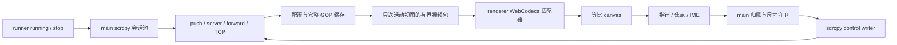

# 投屏与操控产品化 — plan

> 实现记录（2026-10-05）：按 Build order 完成。server 3.3.3 钉版 `resources/` + SHA-256 运行时校验 + extraResources 入包（hash 落位验证）；main 侧 `scrcpy/{transport,cache,control,index}`：会话池按 `{deviceId, runId}` 归属、GOP 有界缓存（8MiB/120 包/1.5s PTS）、ACK 背压（16 包/2MiB）+ 停滞重同步、激活即突发回放（缓存无关键帧时立即 resetVideo）；renderer 侧 PTS 保留的 WebCodecs 薄适配器、等比画布、Pointer/捏合/焦点 IME 输入与物理键工具条；runner 事件经 streamBridge 驱动会话生命周期。真机：单台 CDP 冒烟交互 36-37 帧/s 过线、双会话并测切换 153ms、三种输入注入、退出零残留；i-frame-interval=1 钉死（编码器默认间隔会让 PTS 裁剪与重同步搅动，实测发现后钉死）。PoC harness 已移除。遗留：触摸延迟未产品化精确测量；forward 隧道控制读侧静默（issue：粘贴 ACK 尽力而为）；双指/旋转人手验证待日常使用。

> 仅完成 Step 0、Phase 1、Phase 2；本次不下载 server、不启动模拟器、不改代码。依赖 [runner 草案](2026-10-05-emulator-runner.md) 的真实 running、serial、runId 与停止清理。性能为后续验收目标，不能把单设备 PoC 结果视作产品化已达标。

## Requirements brief（Step 0）

### Background

[PoC](../docs/poc/2026-10-04-投屏链路PoC报告.md) 已验证 host GPU 下单台 59fps / 延迟中位 75ms，但产品主窗仍是 `CanvasPlaceholder`。本步把流移入右侧单画面，支持多设备切换、完整手势与键盘，确保画面和输入始终属于当前选中实例。依据 [PRD](../docs/PRD.md) C、4.1、4.4：交互 ≥30fps、触摸 ≤150ms、后台切回 ≤1s，后台保留连接并停解码。

### Scope

- **Affects**：main 新建 scrcpy 会话池、传输与控制；shared/preload 流和输入契约；renderer DeviceCanvas、输入适配器、工具条和解码生命周期；锁定 server 随包分发及校验；产品化完成后移除专用 PoC harness。
- **Does NOT affect**：runner 状态机与端口分配、目录对账、SDK bootstrap；stage05 的 logcat、截屏/录屏、APK 安装、宿主↔设备剪贴板共享、断网、设置与资源防线。无音频流、独立设备窗、tab、真机、iOS、AHID/UHID 新输入后端、仿真层或新依赖。
- **Boundaries**：主窗只有一个活动画面和输入目标；每个 running 实例保有独立 scrcpy 连接；H.264 + 已验证 `adb forward + 裸 TCP`，server 3.3.3 与当前 Tango 依赖配对，不自动升级。设备停止或 runId 更换即销毁旧会话。

### Requirement

1. 设备 running 后 main 建立流；右侧显示连接中、画面、可重试错误态。投屏失败不把仍运行的 emulator 改成 stopped。
2. canvas 按视频有效尺寸等比居中，容器缩放和设备旋转都不裁切。黑边不接收触控，工具条不遮挡画面。
3. 鼠标左键/单指 Pointer Events 转 Down→Move→Up，支持点击、拖动和长按；不再使用 PoC 的固定 60ms tap 或预制 swipe。
4. 原生双指指针与 Ctrl+左键拖动都能捏合；后一入口用画面中心对称的第二触点模拟。手势结束、失焦、切换、设备旋转或异常时释放所有手指/按键。
5. 画布获得焦点后接收文本与按键；中文 IME 组合期间不重复注入，composition 完成后提交一次文本。输入框、向导、原生弹窗与其他宿主控件获得焦点时不劫持键盘。
6. 工具条提供返回、主页、概览、电源、音量加减、旋转；按钮有中文可访问名称、焦点样式和禁用态。2026-10-07 用户明确电源停止当前模拟器，停止后显示占位，重新运行只走左侧启动；后续方案见 [plan](2026-10-07-rotation-review-and-power-stop.md)。
7. 切换 A→B 时保留 A 的 video/control/adb 连接，持续读取压缩流但停 renderer 解码；切回恢复当前画面 ≤1s。后台不向 renderer 持续广播视频。

### 补充设计轴

以下为 `[recommended — confirm or reject]`：

| 设计轴       | 推荐                                                                                                                |
| ------------ | ------------------------------------------------------------------------------------------------------------------- |
| 缓存与限流   | 每会话缓存配置 + 最新完整 GOP；包队列和 IPC 均有字节/包数上限；拥堵后从关键帧恢复，不任意丢 P 帧                    |
| 竞态         | deviceId、runId、streamId、generation、viewToken、seq 联合标识；旧画面、旧尺寸和旧输入全部拒绝                      |
| 通知         | 连接/解码错误在画布内展示并可重试；操作 reject 经 toApiResult；同一手势失败只提示一次；不用系统 Notification        |
| 权限         | 仅登记主窗可订阅/控制；main 校验当前活动设备和输入尺寸；server 本地固定文件且启动前核验固定 SHA-256                 |
| 文本边界     | 英文普通字符用 injectText；组合文本用设备侧 clipboard+paste，可能改变设备剪贴板；本步不读写宿主剪贴板、不做自动同步 |
| 回归与生成物 | 产品参数不修改设备动画/触摸设置；server 版本、hash、协议选项同源；打包验证后才移除 PoC 页面与通道                   |

文本经设备剪贴板提交是当前 SDK 输入模式字符集限制下的推荐。对禁止粘贴的控件不能承诺任意 Unicode 可输入，需实际验证并显示限制；若要求这类控件也能用宿主中文输入法，需另开 IME/UHID 方案设计，不能静默扩大本步。

## Impact range（Phase 1）

### 当前调用链与差距

`main/poc/index.ts.startStream → adb push/server spawn/forward → TCP video + control → Tango 元数据/包解析 → webContents.send → preload.poc.onPacket → PocApp → WebCodecsVideoDecoder → canvas` 已可用，但只支持固定 serial，全局 controlWriter、videoWidth/videoHeight，没有多会话归属、后台策略、有界缓冲或 sender 权限。

PoC 停流未完整持有所有 socket/reader，renderer 的 onPacket 解绑也未纳入每次 start 生命周期。产品化应显式持有并统一释放，不能照搬全局变量。`App` 当前只按 selectedId 展示占位；主窗关闭与 re-open 需要重新取得活动订阅。

本地安装的 `ScrcpyControlMessageWriter` 已有 injectTouch、injectKeyCode、injectText、rotateDevice、resetVideo、setClipboard；无需另造二进制协议。现有 decoder 的 H.264 实现将 packet PTS 置为 0，不能直接用 VideoFrame.timestamp 判定恢复到哪个包；新的薄解码适配器保留 PTS，并复用 Tango 的 `h264ParseConfiguration`。

### 风险与处理

| 风险                           | 设计处理                                                                                    |
| ------------------------------ | ------------------------------------------------------------------------------------------- |
| 后台停解码后直接喂 delta 黑屏  | 激活时重发当前配置及完整 GOP，从 keyframe 开始；缓存不可用则 resetVideo 等新配置/keyframe   |
| 无变化画面等不到下个 keyframe  | 完整 GOP 按编码 PTS 与字节管理，不按静置墙钟年龄丢弃；可立刻回放现有静态画面                |
| 任意丢包破坏 H.264 依赖        | 超预算时废弃整个待解码依赖段；从新的配置/keyframe 恢复；不能保留坏 P 帧链                   |
| 旋转/切换后触摸落错位置        | generation 与视频尺寸校验；事件坐标扣除居中偏移；旋转先释放触点，等待新尺寸再允许输入       |
| 串设备画面或跨设备 Up          | 包和输入均校验实例代次/活动 token；切换先释放 A 再切目标，不把 A 的 release 送给 B          |
| 多指、拖出画布后手指悬挂       | Pointer capture，pointercancel/lostpointercapture/blur/visibilitychange 清理，main 兜底释放 |
| 中文文本无法由 injectText 表达 | IME 提交走 setClipboard+paste；普通字符不和 keydown 文本重复；明确设备侧剪贴板副作用        |
| 可执行 server 来源不可控       | 构建时固定官方 3.3.3 二进制和 hash，运行时验 hash；不使用 PoC 下载缓存或 renderer URL       |

沿用 [MessagePort 问题的可用替代](../notes/issue/2026-10/2026-10-04-messageport-bridge-no-delivery.md)；一期采用 webContents.send。零拷贝优化不阻挡当前交付。

## Design（Phase 2）

### 会话与资源生命周期

`StreamSession` 按 `{ deviceId, runId }` 建立，含 streamId、generation、serial、scid、server 子进程、forward、两个 socket、媒体/control reader、控制 writer、abortController、格式与缓存。每次 encoder 配置/尺寸重建递增 generation，清除旧 GOP；每次完整重连换 streamId。并发 ensureSession 共享 Promise。

数据流：runner running → 验 server hash → push → 启 server → 独立 scid 的 forward tcp:0 → video dummy-byte 握手 → control → 解析配置及媒体流 → 建缓存。握手读必须处理 TCP 分片/粘包，读去一个 dummy byte 后其余字节继续交给解析器；建议首次连接总预算 15s，可取消，失败回收后显示重试。首次慢启动不计入后台切回的 ≤1s。

连接保持于所有运行设备；激活只改变向主窗发送视频的目标。主窗隐藏/关闭、画布卸载或没有选中 running 设备时激活 null，全部停 renderer 解码；连接继续。重新打开主窗重新订阅。runner stop/crash 清理该会话，主窗渲染崩溃也释放旧订阅与手势。

清理幂等：撤销活动 token/释放输入 → abort 循环 → 关闭 reader/writer/socket → 结束本会话 server 进程 → 删除本会话指定 forward。任何一步报错仍尝试其余步骤；禁止 `forward --remove-all` 或 kill 其他 server。控制 socket 持续解析设备消息（含 clipboard ACK），仅本地处理协议反馈，不同步宿主剪贴板。

### 后台恢复、解码与背压

1. 默认全分辨率 H.264、8Mbps、最高 60fps；推荐 encoder `i-frame-interval=1`。数值是设计预算，必须对目标镜像确认编码器接受并验证性能。后台仍压缩/收包，减少的是宿主解码资源，并非设备编码资源。
2. main 缓存最新配置、最新 keyframe 起的完整包链；建议上限每会话 8MiB、120 个 data 包、编码 PTS跨度 1.5s。按实际包边界与 generation 收口；超限清空链并等待新 keyframe，保持内存有界。静态 GOP PTS 不增长，可保留。配置包另限 64KiB。
3. 激活先装好监听，再发 activate；main 在串行包流中切换 token，并把缓存回放与后续实时包衔接，保证 seq 连续且不重复。renderer 在首帧前显示连接态，不保留另一台画面。
4. 新解码适配器使用原生 VideoDecoder，复用 Tango SPS 解析与 Annex B 配置+首 keyframe 合并；PTS 在当前 generation 内相对归零映射到 timestamp，并保留 seq 对应关系。回放只显示最新已解码输出，恢复计时到回放末包对应帧绘制，不以首个历史 keyframe 或 writer.write 成功算恢复。
5. 每次切换 dispose 旧 decoder、释放 VideoFrame、canvas 旧尺寸与监听；只有活动设备有 decoder。保持输入关闭，直到当前 generation 的画面与尺寸就绪。旋转以实际视频帧尺寸为准，不能仅因 rotate 请求成功就交换宽高。
6. IPC 建议最大 16 包/2MiB 未确认数据，renderer ACK `{ viewToken, generation, throughSeq }` 表示包已消费；decoder.decodeQueueSize 建议不超过 4。遇到暂停、ACK 超时或解码拥堵，不无限发送/积压；作废当前依赖段并从 keyframe 重新同步。配置/关键帧不被 move 限流等输入策略影响。
7. 缓存缺失时用现有 `resetVideo()` 使捕获/编码器重新初始化，等待新配置和 keyframe；它不等于请求单个 IDR，也不重建 adb/控制连接。冷恢复和缓存回放都要实测 ≤1s；若目标镜像不可达标，回到缓存/编码参数设计，不改验收线。

能力检测失败显示明确错误，不引入 CPU 软件解码依赖。优先硬件解码，浏览器选择其他路径时需计入性能测试。decoder output 的 VideoFrame 由适配器在绘制后 close；卸载、reset、异常均释放尚未绘制的 frame。

### 画布与输入

画布布局用可用区域 `W×H` 与视频有效尺寸 `w×h`：`scale=min(W/w,H/h)`，内容大小 `w*scale × h*scale`，偏移各为余量一半。事件从内容 rect 换算归一化坐标；黑边拒绝 down。已 capture 的拖动出界坐标夹到 `[0,1]`；main 换算像素夹到 `[0,w-1]`、`[0,h-1]`。DPR 只影响 backing store，不乘到设备坐标。窗口拖窄、工具条换行、ResizeObserver 与旋转后重算。

普通 pointerId 映射稳定 scrcpy 指针 id；最多两个活动触点。多触点各自 Down/Move/Up，controller 负责 Android pointer index；Ctrl 模拟触点 1 在触点 0 的中心对称位置。模式在 Down 时锁定至结束，不因中途松 Ctrl 改触点数量。move 可按动画帧合并同一触点最新值，Down/Up/Cancel 不丢；main 控制写队列串行、有界（建议 64 事件），过载释放手势并报一次错。

键盘由可聚焦画布及专用文本输入代理接收 beforeinput/composition。英文文本走 injectText，Enter/Backspace/Tab/方向键/修饰键走 injectKeyCode 的 Down/Up；IME 提交一次 Unicode 文本，使用 setClipboard `{ content, paste: true, sequence }` 并读取 ACK，建议最多 4KiB UTF-8/次、2s 超时；ACK 只表示协议确认，不证明被测控件接受了粘贴。组合中不发普通 keydown 文本，避免重复。宿主 Cmd 快捷键保留；本步没有 Cmd+V 的宿主剪贴板读取。

普通文本的 injectText 按 UTF-8 字节分段，每段至多 300 字节，边界不拆字符；这是锁定版本官方 reader 定义的文本预算。控制协议校验还需约束视频宽高为正整数且不超过 u16、指针动作合法、按键/修饰键属于映射白名单，不能仅检验数字有限。

物理键用 main 白名单映射到 Android keycode；按钮发送成对 Down/Up。旋转走 rotateDevice；旋转前释放所有输入。blur、原生弹窗、切换、页面隐藏和 sender 销毁时，main 释放本会话记录的按下键与触点，即使 renderer 来不及发清理。

### 接口、权限与通知

| preload 方法 / shared 通道                     | 契约                                                                                                                |
| ---------------------------------------------- | ------------------------------------------------------------------------------------------------------------------- |
| `screen.activate({ id: string                  | null, viewToken: string })`/`screen:activate`                                                                       | 登记活动视图，返回 stream 现态；listener 必须先安装，早到包按预设 token 识别 |
| `screen.retry({ id, runId })` / `screen:retry` | 仅重建本设备失败的流，emulator 不重启                                                                               |
| `screen.onState` / `screen:state`              | `{ deviceId, runId, streamId, generation, viewToken, status, format?, error? }`；状态 connecting/ready/error/closed |
| `screen.onPacket` / `screen:packet`            | 上述归属字段 + `{ seq, type, pts?, keyframe?, data }`；configuration/data 明确判别                                  |
| `screen.ack` / `screen:ack`                    | 活动 token/generation + throughSeq；拒绝大于已发送 seq 的 ACK                                                       |
| `screen.input` / `screen:input`                | 归属字段 + `{ width, height }` + touch/key/text/rotate/releaseAll 闭集；不暴露原始 scrcpy bytes 或 adb shell        |

所有监听返回解绑函数。main 校验已登记主窗 sender、当前活动 id/runId、token/generation、尺寸、有限坐标、整数指针 id、状态转移及文本字节数；从登记会话取 serial。新输入必须来自当前活动且 ready 的视图；切换释放旧视图由 main 自己执行。socket、server 路径、Android shell 权限不暴露给 renderer。

连接/解码错误显示于画布，重试按钮不停止 emulator；输入错误首次提示，后续同一故障只保留错误态。后台流错误存会话状态，切回时可见，不逐台弹窗。无需 macOS 屏幕录制/辅助功能或通知权限：画面来自设备侧 shell server，焦点输入来自应用本身。

### 文件改动清单

| 文件                                                                                                     | 后续改动                                                           |
| -------------------------------------------------------------------------------------------------------- | ------------------------------------------------------------------ |
| `src/main/scrcpy/{index,transport,control,cache}.ts`                                                     | 会话编排、TCP、控制与有界 GOP 缓存；不引平台总框架                 |
| `src/main/index.ts`、`src/main/ipc/index.ts`、runner 接缝                                                | 注入 running/stop 回调、注册白名单与订阅回收                       |
| `src/shared/{types,ipc-channels}.ts`                                                                     | 流归属、包、状态、输入闭集与通道；单源常量记录 server version/hash |
| `src/preload/api/screen.ts`、`src/preload/api/index.ts`                                                  | 新屏幕域；现有 Api 推导声明随之同步                                |
| `src/renderer/src/components/{DeviceCanvas,DeviceToolbar}.tsx`                                           | 画面与状态、物理键工具条，沿用主题 tokens/lucide                   |
| `src/renderer/src/hooks/{useDeviceScreen,useDeviceInput}.ts`                                             | 订阅、视图代次、Pointer Events、焦点与 composition                 |
| `src/renderer/src/screen/{decoder,geometry}.ts`                                                          | 保留 PTS 的 WebCodecs 薄适配器、纯坐标换算                         |
| `src/renderer/src/App.tsx`、`components/CanvasPlaceholder.tsx`                                           | running 接画布，空态/停止/启动中保留明确引导                       |
| `resources/scrcpy-server-v3.3.3`、`electron-builder.yml`                                                 | 固定二进制和 hash；开发/生产都可取得真实文件路径，打包校验         |
| `src/main/poc/`、`src/preload/api/poc.ts`、`src/renderer/{poc.html,src/poc/}`、`electron.vite.config.ts` | 产品链路验收通过后移除 PoC harness、入口和通道；报告留 book        |
| 对应同级 `__tests__/`                                                                                    | 会话、缓存、归属守卫、几何、手势、decoder 接缝与组件回归           |

## Build order（后续实现顺序，本次不执行）

1. 固定 3.3.3 server 及可信 hash，核验协议配对和打包真实资源；定义归属与输入契约。
2. 抽取 PoC 已验证的传输原理为独立会话；fake socket 验证分片、超时和幂等清理。
3. 实现配置/GOP 缓存、活动订阅、ACK 和切换代次；覆盖静态画面、超限、旧包及旋转。
4. 解码薄适配器与等比布局；验证 frame 释放、PTS 对应恢复末帧、队列有界。
5. Pointer Events、捏合、焦点/IME 与工具条；真机验证地图双指、中文文本、长按、旋转和物理键。
6. 两台 AVD 并行真测性能/切回、窗口关闭与 renderer 重载、流断开重试。通过后移除 PoC harness，生产包再回归。
7. review 只记 issue；实际验收完成再回写 stage04 步骤 5。

## Test plan（后续验证）

- 正常：连接/首帧；竖屏横屏、窄窗与 Retina；点/滑/长按/双指/Ctrl 捏合；IME 中文只注入一次；所有物理键和旋转。
- 边界：黑边、最后一像素、拖出画布、指针取消、同时两指、0 尺寸、后台静态画面、缓存超预算、首配置丢失、快速 A→B→A、当前设备被删、power 关屏再唤醒。
- 错误/权限：server hash 错/缺失、forward 失败、dummy byte 超时、socket 中断、decoder error/能力缺失、ACK 不回、非法/过期 token、旧 runId、文本过长与粘贴被控件拒绝；forward 清理只影响本会话。
- 回归：向导/重命名焦点不把字注入设备；原生弹窗中无悬挂按键；停止/取消立即禁输入；既有 list/theme/IPC 测试与 typecheck/lint/build。
- 性能：沿 PoC 的 10s 交互/20 次延迟采样方法，完整报告中位、P95、最大值和超时，不隐藏尾延迟；目标 ≥30fps / 触摸 ≤150ms。PoC 用中位作闸门，PRD 未明定分位数，不能把它宣传成每次触摸均 ≤150ms。
- 切回：两台 running，活动/静置各测至少 20 次往返；从点击选择到当前设备最新可用帧显示 ≤1s，不能以缓存旧首帧掩盖后续更新；后台无 decoder，adb 保持可用，内存/IPC 队列不随时间增长。日志持续能力由 stage05 测试，本步保证不切断其 adb 接入。

## Done criteria

本次以完整 Phase 2 草案为终点。未来完成需单台及两台真机操控/切换、生产包资源、权限/错误和性能验收全部通过；如恢复或中文输入边界无法达到目标，回到设计而非降级验收；review 记录在案、stage 勾选、plan completed、索引重刷。

## 依据

- 本地依赖的 control writer、H.264 decoder 和 media packet 类型；[TCP 传输经验](../notes/learn/2026-10/2026-10-04-scrcpy-transport-forward-tcp.md)。
- [scrcpy 3.3.3 开发说明](https://github.com/Genymobile/scrcpy/blob/v3.3.3/doc/develop.md)：版本配对与 video/control 传输。
- [scrcpy 控制说明](https://github.com/Genymobile/scrcpy/blob/v3.3.3/doc/control.md)、[键盘说明](https://github.com/Genymobile/scrcpy/blob/v3.3.3/doc/keyboard.md)：对称触点、SDK 字符集与设备剪贴板文本路径。
- 官方 [Controller 源码](https://github.com/Genymobile/scrcpy/blob/v3.3.3/server/src/main/java/com/genymobile/scrcpy/control/Controller.java) 与 [SurfaceEncoder 源码](https://github.com/Genymobile/scrcpy/blob/v3.3.3/server/src/main/java/com/genymobile/scrcpy/video/SurfaceEncoder.java)：resetVideo、paste/ACK 与 codec options。以上方案是基于源码的设计推导，尚未在产品中验证。
- [WebCodecs 规范](https://www.w3.org/TR/webcodecs/)：配置、关键帧、decodeQueueSize 和 VideoFrame 生命周期。
- [ControlMessageReader 源码](https://github.com/Genymobile/scrcpy/blob/v3.3.3/server/src/main/java/com/genymobile/scrcpy/control/ControlMessageReader.java)：300 字节文本预算与视频宽高 u16 编码。
