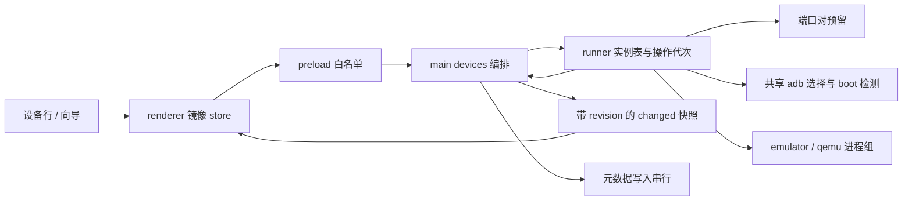
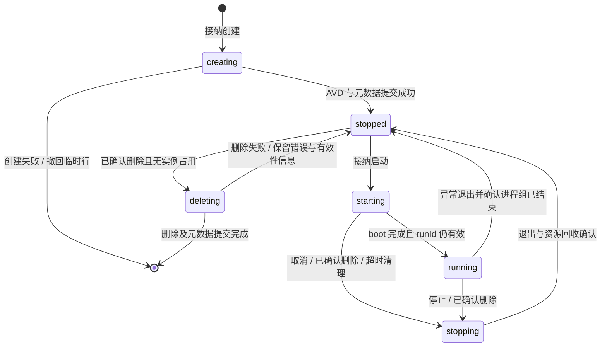

# 模拟器 runner — plan

> 实现记录（2026-10-05）：按 Build order 完成。技术门槛实测先行——emulator 37.2.12 的 console token 恒读写 `$HOME/.emulator_console_auth_token`（`ANDROID_EMULATOR_HOME` 不覆盖），据此 runner 弃用 console（停止走进程组信号），缺口记 issue；共享 adb 以 smart-socket 只读探测保不重启。新增 `emulator/{adb,ports,runner}.ts`，devices 域重写为带 revision 快照与六态状态机，`set-running` 迁移为 start/stop/cancel-start 白名单。单测 169 过；MSD_SMOKE 真机冒烟过：外部 5554 避让、双 AVD 启停/取消、崩溃回写、宿主 token 零改写。列表/serial 复制的真实窗口交互冒烟并入步骤 5 双机真测。

## Requirements brief（Step 0）

### Background

[stage04](../notes/summary/2026-10/2026-10-09-模拟器对接.md) 前三步已完成，应用能创建隔离 AVD，但 `devices:set-running` 仍只改内存。需要把列表操作接到真实 emulator，并使长时间启动、取消、停止和异常退出都有可见结果。依据为 [PRD](../docs/PRD.md) A、F、4.1–4.3；PoC 已验证无头启动及进程组停止。

### Scope

- **Affects**：`main/emulator/` 增 runner、端口与 adb 选择逻辑；devices 域接生命周期；shared/preload 扩展契约；列表展示状态、取消与 serial；主进程退出清理；现有 create/delete 接入互斥和临时状态。
- **Does NOT affect**：投屏解码与输入（[步骤 5](2026-10-05-device-stream-control.md)）；全量目录对账（[步骤 6 草案](2026-10-05-avd-reconciliation.md)）；日志面板、剪贴板共享、并发上限设置与内存水位（stage05）；快照、自动重启、启动排队、iOS/真机、SDK 下载与设置 UI。沿用现有创建参数，不补高级项、排序或 IDE 设备别名。
- **Boundaries**：一期 macOS + arm64 AVD；设备 id 同时是 AVD 名；只管理本进程确实启动的实例。共享本机 adb server 5037；不按 serial/PID 猜测并杀死外部实例。运行态、serial、进程与错误不写入 `devices.json`。

### Requirement

1. 有效且停止的设备点启动，命令接纳后立即显示「启动中」。main 异步 spawn 并检查目标 serial 的 `sys.boot_completed=1`；成功后显示「运行中」和可复制 serial。spawn 成功或 adb 刚出现均不算完成启动。
2. 启动中可取消。取消先撤销本次启动，再终止其进程组；迟到的 boot 成功不能把已取消设备改回运行中。
3. 运行中可停止；停止中禁止再启动。确实退出并释放占用后回停止，停止失败保留阻塞态及重试入口，不能假报成功。
4. 非预期退出回写停止和错误原因；stdout/stderr 只保留有界尾部。允许用户手动重试，不自动重启。
5. 创建期间列表显示「创建中」，创建成功回停止；失败移除临时行并返回错误。创建尚未完成时不允许启停、删除或重命名。
6. 已确认删除时，启动中先取消、运行中先停止，确认退出后再删 AVD；停止失败则不删。停止/删除中的重复请求合并；创建中拒绝删除。删除过程显示「删除中」。
7. 关闭 macOS 主窗只释放其投屏订阅，实例继续运行；真正退出应用先清理本工具实例。异常终止后的残留实例只拦截并提示，不自动接管。

### 补充设计轴

以下均为 `[recommended — confirm or reject]`，只作为草案中的推荐，不代表用户已批准实现：

| 设计轴         | 推荐                                                                                                                       |
| -------------- | -------------------------------------------------------------------------------------------------------------------------- |
| 幂等、竞态     | 每设备操作代次 + 单实例登记；全局端口预留；元数据写入串行；取消可直接打断 boot 等待，不排在它后面                          |
| 事务           | create 写盘失败撤回临时行并尝试删除本次新建 AVD；delete 的文件删除与 JSON 写入无法原子提交，必须报告部分失败并保留异常记录 |
| 通知           | 状态实时推送；用户命令失败走现有原生 dialog；后台崩溃一次提示，同时行内保留错误；主动取消不弹错误                          |
| 回归、数据迁移 | JSON v1 保持不变；IPC 改成带 revision 的快照，避免旧 invoke 结果覆盖新推送；不保留 mock `setRunning` 写状态入口            |
| 权限           | 只有登记的主窗和向导可访问各自白名单；进程与路径只由 main 从已知设备推导，renderer 不传命令、端口或 PID                    |

## Impact range（Phase 1）

### 当前调用链与差距

`App.handleToggleRunning → deviceStore.setRunning → preload.devices.setRunning → devices:set-running → requireDevice().status = … → devices:changed`：全链没有 spawn、端口、boot、取消或 crash 检测。`DeviceStatus` 只有 stopped/running；`DeviceRow` 只按这两态选按钮。

`devices:create → createAvd → persistMetas` 已接官方 `avdmanager`。`devices:delete` 当前对 running 直接拒绝；尚未涵盖 starting/stopping。PoC 的 `startEmulator/stopEmulator` 有固定 5554 端口、单实例全局变量和进程组终止经验，可迁移原理，不能直接作为多实例 runner。其关闭系统动画和启用触摸提示的测量设置不进入产品。

### 风险与处理

| 风险                            | 设计处理                                                                                          |
| ------------------------------- | ------------------------------------------------------------------------------------------------- |
| 只 kill 启动器留下 qemu         | `detached: true` 创建进程组；只向本次持有的组发信号；核查组、端口与实例身份，不能只看 child.close |
| 探测空闲到 spawn 之间被抢端口   | 进程内先预留；外部抢占时识别端口冲突，清理本次进程后换下一对；其他启动错误不盲目重试              |
| 取消后 boot/crash 回调迟到      | runId 匹配才可回写；abort 令牌传播到探测、定时器与启动流程                                        |
| adb CLI 版本冲突重启共享 server | 执行会连 server 的 CLI 前用只读 smart-socket 探测协议版本；不兼容时拦截提示，不静默 kill-server   |
| 应用重启但旧 qemu 尚存          | 启动前查实例身份与 AVD 占用；只提示外部/残留占用，不能标成停止后直接二次启动                      |
| 首载及写盘并发                  | 缓存单次加载 Promise；元数据变更全局串行；运行态更新不用等待长时间文件操作                        |
| 文件与 JSON 部分成功            | 显式错误与一致性提示；对账草案接收遗留状态，不声称 tmp+rename 能覆盖 AVD 事务                     |
| console token 写入宿主 home     | `ANDROID_EMULATOR_HOME` 不能单凭名称视为 token 隔离保证；把实际落点核验作为实施前技术门槛         |

已知问题引用：[首载双读](../notes/issue/2026-10/2026-10-03-devices-ensure-loaded-concurrent-double-read.md)、[落盘分叉](../notes/issue/2026-10/2026-10-03-devices-persist-failure-divergence.md)。前者及本步触及的 create/delete 提交顺序纳入设计，其他元数据功能只为串行提交作必要适配，排除存储层整体重写。

## Design（Phase 2）

### 运行状态与数据形态

`DeviceMeta` 保持原字段。`DeviceStatus` 扩成 `creating | stopped | starting | running | stopping | deleting`；故障不单设 running 的替代态，附 `lastError?: { code, message }`。停止未完成时保持 stopping，并显示重试。设备临时字段增加 `serial?`、`runId?`，预留独立 `availability` 给步骤 6，失效不混进运行状态。

`DeviceSnapshot = { revision: number, devices: Device[] }`。main 每次可见变更递增 revision；list、命令响应和 changed 共用该快照。renderer 忽略较旧 revision。create 返回 `{ createdId, snapshot }`，按明确 id 选中新设备，避免并发创建时取数组尾部选错。向导返回只用于判断本次结果；主窗以快照接收创建中及创建结果。

异常退出但进程组尚存时进入 stopping 做回收，回收失败保持 stopping。serial 只在 main 判定目标身份后发布，停止完成清空；lastError 保留至下次命令成功接纳。创建、删除失败若涉及剩余文件，补一致性提示，不能把停止解释成 AVD 一定有效。

### runner 与端口

- `RunnerEntry` 持有 `{ id, runId, consolePort, serial, child, processGroupId, abortController, phase, stderrTail }`；`start(id)` 同步登记启动任务后异步 boot。重复 start 在 starting/running 返回现态；stop/cancel 同一实例共享清理 Promise。
- 端口按偶数 5554–5682 扫描，同时检查 console 与 `port+1`、共享 adb 设备以及进程内 reservation。范围来自 [Android emulator 文档](https://developer.android.com/studio/run/emulator-commandline)；仅对本次确认的端口冲突换端口。进程组退出前不释放 reservation。
- 启动参数建议 `-avd <id> -no-window -no-snapshot -gpu host -port <even>`；不注入 PoC 的系统动画修改，不强制静音。GPU 失败先报告；swiftshader 只作为显式重试降级，不能宣称达到了 host 的性能线。
- 复用 `defaultSdkRoot/defaultAvdHome`，工具环境只覆盖已确认的 Android 路径项，指向应用自有目录。console token 的重定向方案需对锁定 emulator 版本查 help/源码并实测；若无可用方案，保留隔离缺口并回到设计，不能关闭 auth 或写空 token 规避。
- boot 总超时建议沿 PoC 的 240s、轮询 1.5s、单次 adb 命令 5s；这些是容错上限，不是冷启动验收耗时。取消 abort 后不再轮询；子命令超时必须结束自己，不留挂起 Promise。
- 停止：先释放本设备投屏资源，再向本次持有的进程组 SIGTERM；建议 3s 后 SIGKILL，再给有限清理窗口。没有进程身份依据时不发信号。停止成功要确认实例/进程组已退和占用已释放，不能直接把端口可连接误认为自己仍活着。

### adb 与应用退出

`adb.ts` 解析用户已有 platform-tools（已运行 server 可用的来源、PATH/标准 SDK 候选），验证可执行文件及本地 `adb version`，最后回退应用自有 adb。只连接 `127.0.0.1:5037`；筛掉宿主传入的远程 adb endpoint 环境配置。已有 server 先只读探测；协议不兼容或服务身份无法确定时给出可操作错误，禁止 CLI 自动替换它。没有 server 时可用选定 adb 启动标准 server，成功后再启动 emulator。不同构建版本但协议相容时说明差异，复用而不重启；所有命令固定 `-s <登记 serial>`。

退出 hook 在 `main/index.ts` 装配：第一次 before-quit 阻止退出，拒绝新启动，停止流和本工具实例；清理完成后带 guard 再 quit。有界清理失败提示剩余占用，默认留在应用内允许重试；强制退出不能标作清理成功。macOS window-all-closed 不触发实例停止。

### IPC、权限与通知

| 白名单方法 / 通道                                  | 入参与结果                                                                    |
| -------------------------------------------------- | ----------------------------------------------------------------------------- |
| `devices.start(id)` / `devices:start`              | `{ id }` → 接纳后的 DeviceSnapshot，不等待整个 boot                           |
| `devices.stop(id)` / `devices:stop`                | `{ id }` → stopping/现态快照，实际完成由 changed 推送                         |
| `devices.cancelStart(id)` / `devices:cancel-start` | `{ id }` → stopping/已停止快照；running 时返回状态冲突，不能把迟到取消当 stop |
| `devices.list/onChanged`                           | DeviceSnapshot；shared 通道名单源                                             |
| `devices.create/rename/remove`                     | create 返回明确 createdId；其余返回 DeviceSnapshot，长期副作用由 main 管理    |

`setRunning` 从 shared/preload/store 及测试中迁移掉，不保留可伪造运行态的兼容写入口。main 校验已登记 sender、有效 id、状态和 AVD 最小存在性；步骤 6 未接入前也必须拒绝缺失/不安全 AVD。创建操作仅向导/主窗有权调用；启停仅主窗。禁止 renderer 任意指定 SDK、AVD 路径、serial 或进程标识。

设备行：stopped 显示启动；starting 显示忙态及取消；running 显示停止及 serial 复制；stopping/creating/deleting 显示对应文字并禁用冲突动作。复制走受控文本复制通道，只允许当前登记 serial，不在本步开放任意剪贴板读写。错误由 main 发 `{ eventId, deviceId, runId, code, message }` 至主窗专用 `devices:runtime-error`，renderer 按 eventId 去重弹原生 dialog；命令接纳前 reject 仍走 toApiResult。没有主窗时保留错误，重开后行内展示，避免批量补弹。

### 文件改动清单

| 文件                                                                           | 后续改动                                                             |
| ------------------------------------------------------------------------------ | -------------------------------------------------------------------- |
| `src/main/emulator/{runner,ports,adb}.ts`                                      | 新增实例池、端口分配、共享 adb 选择与命令接缝                        |
| `src/main/emulator/avd.ts`                                                     | 最小存在性/路径验证接缝；不在本步扫描全目录                          |
| `src/main/devices/index.ts`                                                    | 状态编排、单次加载、元数据提交串行、create/delete 生命周期、错误推送 |
| `src/main/index.ts`、`src/main/ipc/index.ts`、`src/main/window/index.ts`       | 装配 runner、sender 登记、退出清理；保持原窗关闭行为                 |
| `src/shared/{types,ipc-channels}.ts`                                           | 状态、snapshot、错误事件、serial 复制与命令契约                      |
| `src/preload/api/devices.ts`                                                   | 白名单迁移，监听均返回解绑函数                                       |
| `src/renderer/src/{App.tsx,stores/deviceStore.ts,wizard/WizardApp.tsx}`        | 快照与新命令适配、错误提示、createdId                                |
| `src/renderer/src/components/{DeviceRow,DeviceListPane,CanvasPlaceholder}.tsx` | 状态、取消、serial、忙态；占位区反映真实状态                         |
| 各模块同级 `__tests__/`                                                        | fake spawn/clock/adb 的状态机与竞态测试，已有列表/向导回归           |

## Build order（后续实现顺序，本次不执行）

1. 核验锁定 emulator 的 console token 路径与共享 adb 不重启策略；验证不触碰宿主 Android 配置，再进入 runner 编码。
2. shared 快照/状态与白名单，迁移全部调用方；以 typecheck 和镜像 revision 测试验证。
3. 端口、runner 单测接缝与取消状态机；先覆盖同设备双启动、外部抢端口和迟到 boot。
4. devices 创建/删除/写入边界与退出编排；验证创建失败、停止失败均不会被报为成功。
5. 列表与 serial 复制；两台自有 AVD 真启动、取消、反复启停、主动终止 qemu 与退出冒烟。
6. review 只记录问题；实际实现验收通过后再按 AGENTS 回写 stage 和 plan。

## Test plan（后续验证）

- 正常：创建中→停止→启动中→运行中→停止；两台不同端口并行且登录态独立；共享 adb 及 IDE 部署目标可见。
- 幂等/竞态：双击启动；同 tick 启动两台；取消与 boot/crash 同帧；stop 与 delete 并发；旧 runId 退出不覆盖新实例；旧 snapshot 不覆盖新推送。
- 边界：64 对耗尽、只占奇数邻端口、探测后被外部抢占、镜像/AVD 缺失、启动超时、spawn error、qemu 残留、停止失败、应用无窗后重开。
- 权限/错误：未登记 sender、未知 id、非法 payload、不能传 shell/端口/PID；adb 不兼容不重启 server；写盘失败撤回内存提交并准确报告文件侧结果。
- 回归：新建/下载/重命名/删除、主题及原生向导；`npm run typecheck`、`npm run lint`、相关及既有测试、构建。
- 真机：冷启动全程 UI 可响应；取消无残留 qemu；崩溃及时回写；主窗关闭不停止实例，quit 清理自有实例；宿主 AVD 与 token 无新增/改写；既有 IDE adb 会话不中断。

## Done criteria

本次设计完成条件：brief、调用链、风险、状态机、IPC、文件范围、测试点齐全，plan 留 draft。未来实现完成条件：上述真机与回归通过；隔离/adb 技术门槛解决；review 只记 issue；步骤 4 才可勾选，plan 才可 completed，索引重刷。

## 依据

- [PoC 实测](../docs/poc/2026-10-04-投屏链路PoC报告.md)、[进程组停止经验](../notes/learn/2026-10/2026-10-04-emulator-process-group-kill.md)、[快照崩溃记录](../notes/issue/2026-10/2026-10-04-emulator-snapshot-resume-crash.md)。
- 官方 [emulator 参数](https://developer.android.com/studio/run/emulator-commandline) 与 [console 认证](https://developer.android.com/studio/run/emulator-console)。网页包含更新后的 CLI 引导；本计划沿用仓库已锁定并实测的 emulator 路径，未迁移新 CLI。
