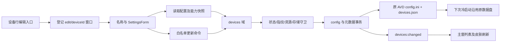

# 已有模拟器配置编辑 — plan

依据：[已确认调研报告](../notes/think-report/20261008104140-已有模拟器配置编辑.md)。2026-10-08 先完成文档，后续已实现编辑入口、差异保存和事务恢复。2026-10-09 按用户指令修复审查清单前 14 项，见[安全修复计划](2026-10-09-emulator-config-safety-fixes.md)。编辑功能已实现；真实应用、登录和各附加字段的完整验收仍未完成，因此保留 in_progress。

## Requirements brief

**背景。** 设备创建后需要调整测试资源、摄像头、网络和外观，同时继续使用已有应用、登录和文件。采用报告 §2 的方案 A：更新原 AVD 配置及元数据，不更换 AVD。

**作用域。** 名称、允许修改的附加设置、编辑窗口上下文、配置回填、保存校验、文件事务、主窗列表反馈。复用创建的 SettingsForm、设置契约与资源通道。

**排除项。** 机型、系统 API、系统镜像、AVD id、排序和创建时间不变；内部存储对所有已有设备只读。无扩缩容、数据盘探查、迁移、重建、擦除、ADB 升级、Quick Boot 开放、跨架构 ABI 或 SD 卡支持。旧向导计划的剩余验收不在本轮结项。

**边界与行为。**

- 设备行进入编辑，直接回填名称和附加配置；机型/API 只展示。运行中可查看，保存要求停止，不自动停止或启动。
- 名称去首尾空格后 1–50 字符；保留已有独立重命名入口。附加设置复用创建的枚举、范围、RAM/heap 联动；未改变且无配置偏差的旧值保留。存在偏差时按下方 2026-10-09 补充规则同步，不按今日默认值归一化。
- 内部存储始终禁用并显示原因；main 拒绝实际变更，编辑写入白名单绝无 `disk.dataPartition.size`。未知原值保持未知，不以 6144 补写。
- 配置变化使快照标记失效，下次冷启动；无偏差时单独改名不动 config 或快照。数据盘及关联文件不进入事务写入集合。
- 保存失败保留草稿并指出字段或恢复措施；设备删除、状态变化、外部改文件、能力变化均在 main 重核验。不同设备互不覆盖。

## Impact range

现状依据：[设备域](../../src/main/devices/index.ts)的 `commitMetas` 只串行元数据；[AVD 模块](../../src/main/emulator/avd.ts)的 `patchAvdConfig` 只支持 set；[向导窗口](../../src/main/window/wizard.ts)没有编辑上下文；[DeviceWizard](../../src/renderer/src/components/DeviceWizard.tsx)的创建能力刷新会重置表单。这四处不能直接套用到编辑。

| 风险                                           | 设计处理                                                                         |
| ---------------------------------------------- | -------------------------------------------------------------------------------- |
| 只改 JSON，配置不生效；复用创建 patch 改坏容量 | 差异映射只写允许键，存储键不在编辑映射中                                         |
| config 与元数据半提交，退出后不一致            | 持久事务记录、失败回滚、启动时恢复；无法确认时冻结目标                           |
| 保存期间启动/删除/改名，或外部修改文件         | 同设备编辑互斥、全局元数据队列、读取指纹与写前再次检查                           |
| legacy null 设置回填新默认值                   | config/所装 schema/legacy runner 默认分来源读取；未知值标注，未改键不写          |
| 皮肤清空仍残留旧路径；摄像头自己占用自己       | skin/name/path 和 orientation 支持删除；占用核验排除目标设备                     |
| 单例窗口静默切换丢草稿或串设备                 | 窗口创建时固定上下文，不同上下文请求聚焦现有窗并提示先关闭                       |
| RAM 填写值与运行值不同                         | 已实测组合提示并使用有效下限；其余说明 Emulator 可能自动调整，真机验收不提前通过 |

## Design

### 1. 契约与权限

拟新增 `WizardContext = create | edit(deviceId)`、`DeviceEditSnapshot`、`UpdateDeviceInput`。快照含固定设备身份、名称、附加值、字段来源/警告、编辑能力、配置指纹及不能保存原因。更新只提交名称和允许字段的差异，另带目标 id 与指纹；额外的画像、镜像字段一律拒绝。

| 接口                          | 入参                                                           | 返回与约束                                               |
| ----------------------------- | -------------------------------------------------------------- | -------------------------------------------------------- |
| `wizard.openEditor(id)`       | 设备 id                                                        | 主窗调用；固定 edit 上下文，不静默切换已有窗口           |
| `wizard.context()`            | 无                                                             | 仅登记窗口读取自己的 create/edit 上下文                  |
| `devices.readConfig(id)`      | 绑定设备 id                                                    | `DeviceEditSnapshot`；只读，不触发启动、迁移或默认值落盘 |
| `devices.updateConfig(input)` | `id`、`fingerprint`、可选 `name`、可选 `advancedSettings` 差异 | `DeviceSnapshot`；main 重验、保存、广播，同 id 更新      |

`advancedSettings` 差异只接纳皮肤、摄像头、网络、朝向、Cold 启动、CPU、GPU、RAM、VM heap；内部存储与 ABI 不属于可写字段。伪造请求不能绕过限制：存储目标与可信原值不同必须拒绝，未知原容量拒绝任何指定容量。无变化值可以丢弃，但绝不写容量键。原始 config 键、宿主路径和任意命令都不接受。

主窗经 `wizard.openEditor(id)` 开窗；登记窗口经 `wizard.context()` 取得上下文。配置读写只允许绑定该 id 的编辑窗口，主窗不直接写附加配置。创建只允许主窗或 create 窗口；皮肤、摄像头资源继续只开放给登记窗口，已有编辑窗可使用。preload 继续暴露 typed API，不增加原始 IPC 或文件访问。

### 2. 回填与校验

配置读取只访问 id 推导的受控 AVD 路径，拒绝 symlink 和越界，延续现有文件大小与检查期限限制。有效值按实际生效顺序回填：启动参数显式覆盖值优先，其次 config，缺省项再查所装 hardware-properties schema；legacy 保持 Cold/host 语义。网络等仅有启动映射的字段从可信元数据读取。保留字段来源，自动值或未知值在界面说明，不假称实际容量或运行 RAM。

读取快照区分明确值、Emulator 自动值与无法识别的旧值，不用 0 统一冒充未知，也不放宽现有元数据守卫来保存占位值。更新提交字段差异及已检测到的可写配置偏差，其余字段原样保留。legacy 的 `advancedSettings=null` 若需持久化运行字段，必须先形成可无损表达的旧行为基线；无法完整表达时按字段保留原语义或禁用相关编辑并说明原因，不能补入新建默认值。单独改名仍可沿用现有路径。

编辑能力按已保存的画像身份、形态及镜像构建，不要求重新选择画像或拉远端镜像清单。当前创建能力限制继续适用；已存值只有改动、待同步及关联字段参与新校验。存储和 ABI 不允许改变；Quick 不能新增，原 Quick 设备修改附加配置时转 Cold。RAM/heap 任一变化或待同步都检查联动；未改旧值不被静默裁剪。

RAM 有效下限由共用能力层提供，创建与编辑使用同一规则。报告仅验证 Emulator 37.2.12.0/build 16428233、`pixel_8`、`system-images;android-34;default;arm64-v8a` revision 2 将 2048 MiB 自动提高到 2560 MiB；该已验证组合修改 RAM 时按 2560 MiB 下限处理，读取仍保留旧配置目标值。规则扩到其他画像、镜像或版本前必须核实对应版本策略，不能把一次实测推广为所有 API 34 的固定下限。其余组合延续现有范围并说明实际资源可能被自动调整。

### 3. 保存事务与恢复

1. 取得设备编辑锁，覆盖全部 await；启动、删除、独立重命名、重复保存拒绝同设备交错。对账暂缓该设备文件判定，文件代次在事务开始/结束变化；迟到扫描结果不能覆盖事务后的状态。
2. 检查 stopped、库可写、即时文件健康与镜像身份、配置和元数据指纹；核验字段差异、摄像头稳定身份与其他设备占用。
3. 在全局元数据提交队列中重新检查 CAS 和原 config。只改名时走元数据提交；附加设置变化时持久记录 old/new config 及 old/new 设备元数据，再原子写 config，最后由 store 唯一入口写元数据。
4. 写元数据失败则恢复原 config；回滚失败保留记录、冻结目标并反馈路径。元数据已提交后清理记录失败不回滚成功结果，重启恢复完成清理。
5. 首载在扫描前恢复未完成记录：元数据还是 old 时回滚 config，已是 new 时完成对应 config；只接受记录中的 old/new 内容，遇外部第三种内容不覆盖，冻结目标。事务记录放 userData 的独立目录，不混入 AVD 扫描根，不备份或操作 userdata。

未知 config 键、注释、AVD ini、镜像路径、画像身份和数据盘保持原内容。清空皮肤删除 `skin.name/skin.path/skin.dynamic`，清空朝向删除 `hw.initialOrientation`。没有变化且无偏差的硬件字段不重写。

全局元数据队列内的文件事务不嵌套调用同一队列，避免自等待。摄像头选择意向在查询完成后、提交之前保留，创建与编辑共用占用裁决，防止两台设备并发拿到同一资源。应用退出时停止接纳新保存，并等待在途事务到达可恢复边界；启动恢复先于文件扫描与设备启动。

指纹同时覆盖原配置字节与目标设备的持久字段。写前再验可检测已发生的外部修改；外部工具不遵守应用锁时仍存在检查与替换之间的竞争窗口，因此不支持与 Android Studio 同时编辑同一 AVD，不宣称指纹能阻止一切外部竞争。

### 4. 窗口与反馈

沿用独立非模态单例、原生三灯、主题 tokens 和现有字段分组。编辑页顶部名称及机型/API 只读上下文，下方共用 SettingsForm；底部取消/保存，说明“保存后下次冷启动生效”。运行时显示“请先停止模拟器”；无改动且无配置偏差时禁用保存。

资源刷新只更新皮肤/摄像头枚举和错误，不重置草稿。失效旧资源仍显示原值和具体提示，可改选或清空。创建和编辑共用资源动作，响应按窗口存活与上下文代次接纳，旧响应不覆盖新草稿。保存成功广播同 id 新快照并关闭编辑窗，主窗保留选中项；失败在窗内显示，保留输入。无系统通知、邮件或新增通知权限。

设备运行状态通过主进程快照订阅更新；设备被删、库冻结或变为运行态时即时禁用保存，不自动刷新覆盖用户输入。配置冲突需重新读取时由用户明确操作，不能用新快照悄悄替换草稿。

### 5. 文件清单

| 文件                                                                         | 改动                                                                         |
| ---------------------------------------------------------------------------- | ---------------------------------------------------------------------------- |
| `src/shared/types.ts`、`ipc-channels.ts`、`settings-contract.ts`             | 编辑读取/差异更新契约、通道、校验与白名单映射；自动/未知值仅在读取快照中表达 |
| `src/main/emulator/deviceConfig.ts`、`configTransaction.ts`                  | 受控读取、指纹、来源、set/delete、事务及恢复                                 |
| `src/main/devices/index.ts`                                                  | 读取/更新编排、互斥、CAS、恢复、广播                                         |
| `src/main/window/wizard.ts`、`src/main/emulator/index.ts`                    | 固定 create/edit 上下文与 sender 守卫                                        |
| `src/preload/api/devices.ts`、`wizard.ts`                                    | 类型化桥接，Api 派生类型自动同步                                             |
| `src/renderer/src/wizard/WizardApp.tsx`、`components/DeviceEditor.tsx`       | 编辑路由、回填、资源动作、保存及草稿错误                                     |
| `src/renderer/src/components/wizard/SettingsForm.tsx`                        | 创建/编辑共用字段，编辑只读及未知原值提示                                    |
| `src/renderer/src/components/wizard/` 的共用资源逻辑                         | 创建/编辑复用皮肤、摄像头动作，保留各自草稿与代次                            |
| `src/renderer/src/components/DeviceRow.tsx`、`DeviceListPane.tsx`、`App.tsx` | 行内编辑入口与打开失败反馈                                                   |
| 相邻 `__tests__/`                                                            | 契约、事务、域守卫、编辑表单与创建回归（Phase 4）                            |

## Build order（实现轮 2026-10-08 执行完毕）

1. 共享编辑契约与差异映射，核对存储键不会出现、未知旧值不被归一化覆盖。
2. 配置读取和文件事务，接入首载恢复；用临时目录验证 set/delete、失败回滚和恢复分支。
3. devices 读取/保存及互斥，接 preload 和窗口上下文；验证非法 sender、固定身份、stopped 和指纹边界。
4. 复用表单实现编辑页和设备行入口；确认能力/资源刷新保留草稿，成功同 id 更新。
5. 执行 typecheck/lint/build 与关键检查，记录 Phase 3 状态；进入完整测试、review 和收尾前按 workflow 分别验收。

实现结果（feature/device-config-edit 分支）：① `UpdateDeviceSettings` 差异闭集 + `sanitizeUpdateSettings` 拒绝存储/ABI/未知键；`effectiveRamMin` 共用 RAM 下限（实测组合 2560）。② 新增 `src/main/emulator/deviceConfig.ts`（受控读取/指纹/set+delete patch/schema 回退）与 `configTransaction.ts`（journal 持久记录 + 内容裁决恢复）；首载在扫描前恢复。③ devices 域新增 readConfig/updateConfig：设备编辑锁互斥启动/删除/重命名、指纹 CAS、全局元数据队列内跨文件事务、失败回滚/冻结；wizard 窗口固定 create/edit 上下文，资源通道沿用登记窗守卫。④ 新增 DeviceEditor 编辑页（共用 SettingsForm，存储只读、草稿不被资源刷新重置），皮肤/摄像头逻辑抽 `useWizardResources` 供创建/编辑共用；设备行加编辑入口。⑤ typecheck/lint/build/test 全绿（601 项，含 62 项新增：deviceConfig 15、configTransaction 10、settings-contract 7、devices 编辑域 19、DeviceEditor 9、effectiveRamMin 2）。真 AVD 验收未执行（Phase 4 关卡）。

## Test plan

| 维度           | 验证点                                                                                                        |
| -------------- | ------------------------------------------------------------------------------------------------------------- |
| 正常路径       | name、RAM 扩缩、heap、CPU、GPU、网络、朝向、皮肤、摄像头；同 id 更新及下次冷启动                              |
| 固定字段与权限 | 存储伪造变更、画像/镜像额外字段、错设备编辑窗、未登记 sender、create/edit 隔离                                |
| 旧值与边界     | legacy/null、schema 自动值、未知容量、外部 config 不一致、不可用皮肤/摄像头、空名/超长名、整数/范围/heap 联动 |
| 竞态与错误     | 运行中保存、保存并发启动/删除/改名、连续保存、不同设备、外部改库/改 config、写失败/回滚失败、退出中断恢复     |
| 界面与回归     | 创建向导保持初始容量输入；资源刷新不丢草稿，错误可读，运行态变更；亮暗与最小窗宽，键盘焦点与取消              |
| 真 AVD         | 仅专用临时 AVD：冷启动核对资源、网络、摄像头、朝向/皮肤及应用/登录/文件保留；不操作用户已有数据               |

## Done criteria

初次文档交付已完成，后续实现与安全修复均已落地。开发计划只有实现及 Phase 4—6 关卡均完成后才改 `completed`；不以局部冒烟替代下列完整验收。

- 功能符合全部已确认边界，内部存储无任何编辑写入路径，固定身份和数据盘保持。
- 完整测试、typecheck、lint、build 全绿；真实应用和登录保留有验收结果，未验项明确记录。
- review 发现只记录 issue，修复另开一轮；book/learn/issue/索引同步，正式 stage 步骤获批且完成后再勾选。

## Workflow 状态

- [x] Step 0：需求 brief 已由报告及本轮指令确定。
- [x] Phase 1 分析：调用链、影响范围与风险已记录。
- [x] Phase 2 设计：接口、权限、通知、事务、交互与测试点已记录。
- [x] Phase 3 实现：feature/device-config-edit 分支按 Build order 1–4 完成，typecheck/lint/build 全绿（结果见 Build order 段）。
- [ ] Phase 4 测试：自动化单测已完成（62 项新增、全量 601 项全绿）；真 AVD 验收（冷启动资源/网络/摄像头/朝向/皮肤、应用与登录保留）未执行，关卡未过。
- [ ] Phase 5 Code review：2026-10-08 已执行审查并记录 issue，2026-10-09 安全修复轮另有结构化 review；完整功能验收后仍需核对最终交付。
- [ ] Phase 6 收尾：待执行；本计划不提前 completed。

当前没有对应的正式 stage 步骤；本轮不新增或勾选 stage，不改变旧向导 plan。后续立项时由用户决定加入哪个阶段及执行顺序。

## 2026-10-09 安全修复边界

只校验实际编辑、待同步及 RAM/heap 关联字段；未改且无偏差的旧值原样保留。legacy 无法无损解析附加设置时仅开放名称与明确的挖孔恢复，不补写创建默认值；可识别 legacy 沿用 host GPU。运行→停止实时解除状态阻断。内部存储、机型/API 和数据盘仍固定。

恢复事务同时比较 config 与元数据，第三种内容或缺失冻结；读写检查父目录 symlink，写前复验内容。摄像头预留覆盖创建/编辑提交与回滚；提交后的 journal 清理失败仍反馈成功，下一次事务先清理旧记录。RAM 下限只匹配已验证版本/build/镜像 revision，默认值同步下限。

历史挖孔来源无法自动判定。编辑页提供“恢复安卓默认挖孔”，下次启动只操作目标当前用户的内置 cutout 模拟包，并等待新的安卓启动代次；普通保存不请求恢复。此修复不代表 Quick、跨形态、相机取景等完整验收已完成。

## 2026-10-09 配置偏差采用与同步

按用户新需求实现[补充计划](2026-10-09-config-mismatch-reconcile.md)：已有可写配置偏差逐项提供“采用配置值”，仅更新对应表单；不点击时保存也以当前表单同步该偏差。待同步字段必须通过能力、RAM/heap 和相机即时复验，main 重算集合；无偏差旧字段仍保留。228 与 228M 等价时不告警，采用时保留原文件写法。缺失键与默认继承语义不扩大为新冲突，存储/ABI 不进入同步范围。

全量 671 项通过、6 项跳过，typecheck/lint/build 与格式检查通过；本次预览未修改用户 AVD。完整真实验收和[补充复查的 4 项问题](../notes/issue/2026-10/2026-10-09-config-safety-followup-audit.md) 仍独立跟踪，本主计划保持 in_progress。
