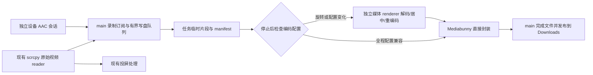

# 模拟器与真机录屏 — plan

已完成 [workflow](../guidelines/workflow.md) 的 **Step 0、Phase 1、Phase 2、Phase 3 实现**。2026-10-16 用户授权在当前 worktree 开发，并批准依据模拟器证据继续正式实现、将 Android 13+ 真机音频验收后移到交付前，功能范围与同步目标不变。[P0 报告](../docs/poc/2026-10-16-recording-p0.md) 与 [正式实现验证](../docs/poc/2026-10-16-recording-implementation.md) 分别记录先行探针和产品管线结果。1282 项测试通过，但十分钟同步最大 112/106ms 超过 100ms，真实设备音频与交互性能待验；Phase 4 未过，plan 保持 in_progress。

依据：[调研与逐轮确认](../notes/think-report/20261016124043-模拟器录屏.md)、[stage05 录屏半步](../stage/05-功能完善.md)、[stage06 真机来源](../stage/06-真机接入与投屏.md)、[PRD D 组](../docs/PRD.md)。

## Requirements brief — Step 0

### Background

测试人员在应用中复现问题，需要把某台设备的画面和设备声音录下来。现有截屏、APK 安装、日志与投屏均已接入；没有录屏域。旧 stage 的截屏/录屏组合步骤虽已勾选，录屏半边仍未实现，不用该勾选替代本计划验收。

### Scope

- Affects：scrcpy 原始视频订阅接缝、按需设备音频会话、主进程录制任务/临时文件/最终文件、独立媒体处理 renderer、preload 与 shared 契约、两类画布工具条、主窗录制任务区、三语字典、退出与设备停止收尾、构建入口及第三方许可。
- Does NOT affect：设备创建/编辑/镜像下载、AVD 数据隔离、SDK 来源策略、剪贴板、APK 安装、日志和网络功能、投屏输入协议及 ACK/回放算法；不顺手修复初次建流重试等既有 issue。
- Boundaries：macOS 宿主上的 Android 模拟器、USB/无线真机；本地离线运行；只录指定设备屏幕与设备输出声，不包含皮肤、工具条、宿主声音或任一麦克风。不做剪辑、GIF、上传、应用内播放、多个设备拼接、跨重连自动续录。

### 已确认行为

| 能力     | 交付行为                                                                                                                    |
| -------- | --------------------------------------------------------------------------------------------------------------------------- |
| 文件     | 每台设备每个任务单独产出 MP4；多个设备各存各的视频                                                                          |
| 暂停     | 同一个任务暂停/继续；暂停内容和续录等待区间不进入成片；有效录制用时不计暂停                                                 |
| 切设备   | 选择 B 不影响 A 的录制；A 继续记录 A 的实时状态，不能改录 B 或停留在 A 的旧截图                                             |
| 未旋转   | 按当前设备屏幕尺寸输出；采集被编码器降级时必须说明实际尺寸                                                                  |
| 旋转     | 最终宽度为有效画面最大宽度，高度为最大高度；各段原比例居中，空位黑色，不裁切、不拉伸；1080×2400 与 2400×1080 得到 2400×2400 |
| 编码上限 | 最大画布超过能力时，明确提示后允许等比缩小；不能静默降质                                                                    |
| 声音     | 录设备输出并保持设备本地出声；采音不可用时提示，由用户选择无声继续或取消                                                    |
| 保存     | 默认系统下载目录；停止后可能先生成视频，成功后才显示保存完成                                                                |
| 完成操作 | 只提供「在文件夹中显示」；用户从文件夹自行打开视频，无自动播放或应用内播放按钮                                              |
| 并发     | 支持独立设备分别录制，设置并发上限；数值由验证决定，不能借用模拟器启动上限                                                  |

## Impact range — Phase 1

### 当前接缝与影响

| 真实文件                                                                 | 当前事实                                                       | 设计变更                                                                   |
| ------------------------------------------------------------------------ | -------------------------------------------------------------- | -------------------------------------------------------------------------- |
| `src/main/scrcpy/session.ts`                                             | main 持有原始媒体 reader；流在后台继续读取                     | 增加录制订阅分发；在视图流控之前取得编码包                                 |
| `src/main/scrcpy/media.ts`、`types.ts`、`lifecycle.ts`                   | 配置换代、回放、清理与活动视图关联                             | 增加只读源快照/订阅/结束通知；不从 sendPacket 或 GOP 回放录视频            |
| `src/main/scrcpy/transport.ts`                                           | server 3.3.3，audio=false，视频与控制双 socket                 | 复用版本/hash/环境约束；独立音频 transport 不改变原视频握手                |
| `src/main/devices/queries.ts`                                            | deviceRefOfId 支持 AVD 和真机；不含完整流代次                  | 查询设备名称/serial，另从 scrcpy 取原子身份；不让 renderer 提供可信 serial |
| `src/main/ipc/index.ts`                                                  | AVD running/stopped/beforeKill 与外部 connected/removed 两条桥 | 装配录制域；设备停止先截止录制、释放音频，离线生成继续                     |
| `src/main/index.ts`、`window/index.ts`                                   | 退出先清设备和流；activate 根据所有窗口数判断                  | 接入录制退出处理；隐藏处理窗存在时，仍按主窗是否存在决定重建主窗           |
| `src/preload/api/recording.ts`、`index.d.ts`、`src/shared/`              | window.api 单源白名单                                          | 增加录制与受控媒体处理接口；类型声明继续引用 Api，不复制第二套             |
| `DeviceToolbar.tsx`、`DeviceCanvas.tsx`、`ExternalCanvas.tsx`、`App.tsx` | 两类设备共用工具条，画布随选中切换                             | 工具条发录制命令；App 级任务镜像不随画布卸载                               |
| `electron.vite.config.ts`                                                | 六个 renderer HTML 入口                                        | 新增不可见媒体处理入口，验证 dev 与打包路径                                |

### 主要风险与处理

1. **音频不能靠 audio=true 一行接通**：新增 socket 会改变握手顺序；独立 audio-only 会话需证明与已有视频会话并存。
2. **设备本地出声**：官方 output 源会抑制本地播放，不能作为保持本地出声的隐式 fallback。优先验证 Android 13+ playback/dup；较旧系统或应用拒录时进入无声选择流程。
3. **暂停与时间戳**：现有投屏 PTS 为微秒，Mediabunny 时间为秒；独立音视频会话不能各自归零。需共同时间基准、边界裁剪及静止尾帧时长。
4. **旋转**：最终画布到停止时才确定；先保留可处理片段，再统一生成。单改 MP4 rotation 元数据无法实现本需求。
5. **背压**：录制写盘不得阻塞现有视频读取；队列溢出要终止该录制任务并说明，不能任意丢增量帧后宣称录像完整。
6. **USB/无线重复实体**：相同手机的两个 transport 不能盲目启动两个音频采集；P0 核实稳定实体身份，无法判断时明确限制并行，不擅自合并设备列表。
7. **后台与退出**：隐藏处理页不归主窗所有，不能被 closeMainWindow 带走或阻止 macOS 重开主窗；真正退出必须先处理未完成录制。

## Design — Phase 2

### 1. 总体数据流

main 是任务和文件唯一事实源。媒体页只做解码、合成、编码，不访问任意文件系统；可见画布只显示当前设备，与录制无所有权关系。Mediabunny **1.61.5** 是验证起点；采用前核对实际 API、打包产物与 MPL-2.0 许可，并锁版本，不使用漂移的 latest。

不引入完整 scrcpy CLI、FFmpeg、桌面截屏权限或 Node 原生编解码扩展。P0 若证明当前路线不可用，回到设计，不悄悄替换技术栈。

### 2. 必须先通过的能力验证 P0

这是后续 Phase 3 的第一个实施批，本轮只设计验证方法。验证代码放独立 PoC 位置，不能先把未经验证的产品开关接到用户界面。

| 验证             | 必须得到的证据                                                                               | 失败处理                                                             |
| ---------------- | -------------------------------------------------------------------------------------------- | -------------------------------------------------------------------- |
| MP4              | Electron 实际运行环境中 H.264+AAC 可封装、播放、拖动；Annex B 配置/关键帧与 AAC 配置适配正确 | 停止正式集成，记录具体失败与版本                                     |
| 双会话与本地出声 | 模拟器、USB、无线各测；audio-only 独立 scid，不打断视频或抑制设备播放                        | 设备标为采音不支持，验证无声选择；若所有目标均不可用则方案不通过     |
| 时间基准         | 原始视频/音频 PTS、开始/暂停/继续/停止边界；至少 10 分钟、多次暂停后的可观察声画同步         | 不以宿主收包时间替代设备 PTS 掩盖漂移                                |
| 编码与尺寸       | 竖→横→竖生成最大画布；VideoEncoder.isConfigSupported 之外还要试编码；超过能力测试等比缩小    | 写明支持配置和实际输出，不把 API 返回 true 当性能保证                |
| 长静止           | 开始、续录、停止均覆盖静止画面，最后有效画面保持到有效停止边界                               | 关键帧等待有界；无画面任务不能保存成成功文件                         |
| 并发             | 1、2 个独立设备开始递增，记录主进程内存、磁盘队列、投屏 fps/延迟与生成耗时                   | 产出录制上限及依据；至少验证两独立任务，不能把单任务冒烟当多设备验收 |
| 后台与打包       | 选中别的设备、主窗关闭重开、隐藏页、离线打包版仍可生成                                       | 明确页面策略与资源释放，不依赖仅 dev 可用的路径                      |

P0 产出带版本、机器、设备、原始测量与通过/失败结论的 `book/docs/poc/` 报告，同时把并发上限、编码配置、单任务字节队列上限、I/O 批大小和超时填写进本文「验证参数」。2026-10-16 用户批准的关卡调整：依据模拟器验证结果继续正式实现，Android 13+ 真机音频留在 Phase 4 待硬件验收；其余性能与生命周期项在正式实现中验证。原始 PTS 漂移不能销账，采用保留共同起点的 AAC 采样时钟并严格校验配置及断流。同步目标仍为 ≤100ms，缺真机不算通过；全部需求不变。用户已允许运行参数由实测确定。

### 3. 录制任务与身份

- `RecordingTarget`：deviceId、deviceName（开始时快照）、serial、runId、streamId、physicalKey（能够可靠识别时）。只有 main 查询和创建；不得信任 renderer 传入的路径/serial。
- `RecordingTask`：taskId、revision、target、state、audioState、activeDurationUs、bytesWritten、segmentCount、maxWidth/maxHeight、outputSize、stopReason、error、savedFileName。临时绝对路径与文件句柄留 main。
- `audioState`：preparing、available、unavailable、silentByChoice。音频“正常静音”与采集失败分开；不凭一段没有声音就猜测应用拒录。
- main 同步占位后再 await：同 deviceId 同时最多一项采集任务；pause 仍占采集名额。多个设备各自持有 taskId 与输出；已停止且正在生成可排队，不占采集名额。生成队列一次处理一个任务，控制编码资源。
- scrcpy 增加 `getRecordingSource(id)`、`subscribeRecordingSource(identity, observer)` 和 `requestRecordingKeyFrame(identity)` 窄接口。订阅验证 identity；observer 只入有界队列，异常只影响录制，不向视频 reader 抛出。
- 配置 generation 改变是新片段；runId/streamId 改变是旧任务结束原因，不能自动跨连接拼接。旧回调只可作用于原 taskId/identity。

### 4. 状态机与命令串行

`idle → starting → recording ⇄ pausing/paused/resuming → stopping → queued/processing → saved`；无采音时可从 starting 进入 `awaiting-silent-choice`；设备失联或资源故障附 `interruption` 原因，封存后 queued/processing/saved 仍保留中断标识；无法恢复的产物为 error，不显示普通保存成功。

| 操作/事件             | 规则                                                                                                                |
| --------------------- | ------------------------------------------------------------------------------------------------------------------- |
| start                 | 验证主窗 sender、设备和源代次、名额；申请任务后准备音频/关键帧。音频不可用必须等用户选择；取消释放占位及全部资源    |
| chooseSilent          | 仅 awaiting-silent-choice 可执行；接受后标 silentByChoice，任务和结果都显示无声                                     |
| pause                 | 按任务串行封闭当前有效区间，排空区间内已接受的写盘；暂停界面设备仍可操控、音频流可持续读但不落盘                    |
| resume                | 等配置+可独立解码关键帧，再建立新有效区间；此前媒体不进入成片，等待时显示正在继续                                   |
| stop                  | starting/awaiting-choice 可取消；recording/paused/resuming 等截止并排空。重复 stop 幂等；生成中不能重新开启同一任务 |
| disconnect/stopDevice | 先截止原任务并释放音频，不等待离线转码才允许停止设备；原有片段可生成，结果说明中断原因                              |
| retryGenerate         | 只重试已封存输入，不重连或继续采集旧任务；上次失败临时输出先隔离，禁止并发生成同任务                                |
| dismiss               | 只关闭终态展示；活动任务不可用关闭图标伪装停止                                                                      |

### 5. 暂停时间轴、片段与尾帧

1. 内部统一 bigint 微秒；仅进入 Mediabunny 时除以 1,000,000 转秒。区分解码顺序、呈现 PTS、视频配置、音频配置；禁止拿 IPC 序号当时间。
2. 保存有效区间 `[sourceStartUs, sourceEndUs)` 及其 outputStartUs。音视频共用映射 `output = source - sourceStart + outputStart`；两轨不得独立以首包归零。P0 必须证明两会话时钟关系；不成立就回到采集设计。
   P0 修订候选：当前 AAC 连续流原始 PTS 在 620 秒后比实际采样时长多出约 319–414ms。保留首音频 PTS 与视频的共同起点，后续按累计采样数推进；用户已批准先据此实现，Android 13+ 真机验收后移。修订仪器后旧样本为 46/120ms，正式短录为 72/79ms、十分钟为 112/106ms，不能宣称同步已过。实现从 AAC AudioSpecificConfig 推导采样率/声道/每帧样本数，正常静音照常推进、断流/重配置明确中断任务，不套用探针的固定 48kHz/1024 样本。
3. start/resume 等待第一张可解码画面，配置与关键帧一起开段；此前音频丢弃。关键帧请求不依赖 active view，也不改变主窗焦点；请求合并且有界，复用协议能力但不复用 active-view 恢复状态机。
4. pause/stop 的无新帧边界通过单调时钟与已验证 PTS 锚点映射，补齐最后画面的有效时长；不强迫静止设备不断产生新帧。AAC 按样本帧边界处理，验证连续同步；若直接封装不能满足边界，转码该任务，不能粗暴删除导致漂移。
5. 不保存暂停期间的画面；未写入有效画面的方向变化不扩大最终画布。任一有效区间无关键帧则没有成功片段；任务全程无有效画面时报错并清理空输出。
6. 连续旋转以新关键帧的设备 PTS 关闭旧配置段，新段标 continuous；两段输出映射连续，AAC 跨此边界保留，不把 socket 到达抖动插成片段长度。暂停/停止的尾帧才使用单调时钟投影。每个临时段记录 codec configuration、尺寸、首尾 PTS、数据索引、区间归属；二进制包流式写入，不把媒体数据放 JSON。manifest 以临时文件+原子替换更新；完整尾记录之外的崩溃残片不能直接当有效数据。

### 6. 尺寸决策与生成

- 只按该任务有效画面统计 `W=max(width)`、`H=max(height)`。无方向/配置变化且片段兼容时尝试原编码封装；否则全部有效片段生成统一 W×H 视频。
- 默认保留采集分辨率，先比对设备屏幕和采集尺寸；若 scrcpy 已降采集尺寸，开始录制前明确说明，不能宣称原生尺寸。
- 固定画布全黑，内容保持比例居中。偶数编码对齐时只补边，不裁内容。1080×2400→2400×1080→1080×2400 的所有时段都输出 2400×2400。
- 超编码能力时按统一缩放比例搜索可编码的偶数尺寸，展示原尺寸与建议尺寸，用户已允许提示后缩小；能力探测和真实试编码均通过才接受。连最小候选都不可编码则失败并保留材料。
- processing 使用独立隐藏媒体 renderer，按 manifest 读取有界批次、顺序解码到 OffscreenCanvas/Canvas、编码 H.264；编码结果返回 main 由 Mediabunny 封装。AAC 尽量直接封装，允许为精确裁剪走经过 P0 验证的音频处理路径，不能偷偷采宿主声音。
- VideoFrame/编码队列及时释放；进度按有效时长计算，只用可确定的进度，不承诺 ETA。时间轴采用有效区间，黑边不是暂停占位。

### 7. 文件、异常与退出

- 临时工作目录为 app userData 下受控 `recordings/<taskId>/`；使用规范 UUID，避免设备名进入目录路径。最终文件通过 `app.getPath('downloads')`，文件名为安全化设备名+本地时间戳，重名递增。
- 生成到下载目录内独立 `.part` 临时文件，完成 MP4 finalize、句柄关闭和结构检查后再无覆盖发布；不要把 cross-volume rename 当原子提交。失败清理由 taskId 精确定位，绝不删用户原文件。
- saved 后只把 taskId/显示文件名发 UI；reveal(taskId) 从 main 的成功记录解析路径并调用 shell.showItemInFolder。拒绝任意路径，文件被外部删除时给出明确反馈。
- 正常完成后清临时媒体，错误保留 manifest 以便重试。启动扫描本域孤立任务，只呈现可重试生成/清理，不自动恢复采集；不扩展为录像历史库。手动删除残留用原生确认，路径仍由 main 决定。
- macOS 关闭主窗不停止任务；重开主窗拉快照。隐藏处理窗不阻止主窗 activate 重建，且不计作可见业务窗口。渲染处理页崩溃只结束当前生成，保留输入重试，不结束采集任务。
- 真正退出时冻结新 start，若存在采集/生成任务，用原生短确认提供「停止并保存后退出 / 留在应用 / 放弃未完成任务并退出」。保存分支先封存录制再停设备、排生成队列，完成后退出；失败回到明确提示。放弃分支有界取消，保存已成功文件不删；不得全局 kill-server 或终止其他应用进程。

### 8. IPC 与处理页安全边界

| 通道（在 shared 单源声明）                          | 输入                                                | 返回/推送                                                       |
| --------------------------------------------------- | --------------------------------------------------- | --------------------------------------------------------------- |
| recording:start                                     | deviceId                                            | taskId 或带 reason 的拒绝结果                                   |
| recording:command                                   | taskId, pause/resume/stop/retry/reveal/dismiss 闭集 | 全量带 revision 的任务快照                                      |
| 无声选择                                            | main 原生 dialog，不开放 renderer 接受开关          | 无声继续或取消，过期任务忽略答复                                |
| recording:get                                       | 无                                                  | revision + 全部当前任务 + 并发能力                              |
| recording:changed                                   | main 推送                                           | 全量带 revision 的任务快照；订阅先安装，再 get，拒绝旧 revision |
| recording:processor-size                            | job/token + 实际候选宽高                            | main 提示缩放并记录批准尺寸                                     |
| recording:processor-ready/pull/push/complete/failed | jobId、一次性 token、batchSeq 及有界数据            | 媒体批次/确认；仅已登记处理页 sender 可用                       |

命令先做运行时类型、长度、状态与所有权校验；未知 taskId 不触碰文件。UI 错误经 toApiResult 有归宿。处理页只接受 main 分配的 job token，不能 start、控制设备或 reveal；主窗不能伪装处理页写任意产物。批次限制由 P0 参数表固化，错序/超限直接终止该 job。

### 9. 界面 brief（impeccable，Operate）

- 面向现有专业测试用户，沿用 DESIGN.md 的发丝线、tokens、lucide 图标、单 Wrapper、三语；不增加渲染层模态框、装饰性卡片或新的设置分类。
- 共用工具条在截图旁增加录制入口；当前设备录制中显示暂停/停止，暂停后显示继续/停止；所有图标有明确可访问名和键盘焦点。控件状态跟主进程 task，不跟画布解码状态猜测。
- 当前设备计时位于 Logcat 左侧同一工具组、垂直居中并相隔 12px；左侧模拟器/真机行只显示录制状态。停止后计时位置显示生成进度；保存成功/失败改由 main 原生 dialog 队列呈现，旧顶部结果条移除。此为用户后续两轮访谈确认的最终交互，见 [交互 plan](2026-10-16-recording-interactions.md)。
- 窄窗计时和日志保持独立间距，底部工具条可换行；成功结果只提供文件夹定位/关闭，失败重试或稍后处理，材料保留，不自动播放。尺寸/无声确认按设备和条件记忆，设置通用一键恢复。
- starting/resuming/processing 分别显示真实阶段；无声选择与缩小提示用已有原生 dialog；选中切换本身不弹确认、不停止任务。任务生成后用户关闭提示不删除文件。

### 10. 文件清单

| 新增/修改        | 文件与职责                                                                                                                                                                                                                                                                                                             |
| ---------------- | ---------------------------------------------------------------------------------------------------------------------------------------------------------------------------------------------------------------------------------------------------------------------------------------------------------------------- |
| 新增 main 录制域 | `src/main/recording/index.ts` 装配；`manager.ts` 状态与串行；`capture.ts` 媒体采集/开段；`source.ts` 配置解析与生成输入；`audioTransport.ts` 设备音频；`timeline.ts` 区间映射；`segments.ts` 临时段；`output.ts` MP4；`publish.ts` 发布与 reveal；`processor.ts` 处理页调度；`limits.ts` P0 参数；`copy.ts` 主进程词条 |
| 修改 scrcpy      | 新增 `recording.ts` 只读订阅/关键帧请求；`types.ts`/`index.ts` 暴露窄接口；`media.ts` 原始分发；`lifecycle.ts` 结束通知；请求保持 identity 守卫，不改输入与 ACK 协议                                                                                                                                                   |
| 修改装配/退出    | `src/main/ipc/index.ts`、`src/main/index.ts`；隐藏页注册与回收收敛在 `src/main/recording/processor.ts`（与 job 身份同一所有者），复用现有主窗所有权查询                                                                                                                                                                |
| 新增媒体页       | `src/renderer/recording-processor.html`、`src/renderer/src/recordingProcessor/index.ts` 与私有处理模块；`electron.vite.config.ts` 接入口                                                                                                                                                                               |
| 修改契约         | `src/shared/recording.ts`、`ipc-channels.ts`、`src/preload/api/recording.ts`；`index.d.ts` 沿用 Api 引用；三语 `src/shared/i18n/recording.ts` 与导出                                                                                                                                                                   |
| 新增/修改 UI     | `RecordingControls.tsx`、`RecordingIndicator.tsx`、`RecordingStatus.tsx`、`recordingPresentation.ts`、`stores/recordingStore.ts`；App、两类设备行/画布/工具条和设置通用；旧 RecordingTasks 已在后续交互批移除                                                                                                          |
| 依赖与文档       | `package.json`/lock、第三方许可分发、PRD D/4.1 与相应 ADR（实施前补齐）、P0 报告；不修改既有架构边界                                                                                                                                                                                                                   |

每个模块测试放同级 `__tests__/`。文件名是落点约定；实现若需调整职责边界，先更新本设计，不把一个 manager 写成所有职责的单文件。

## Build order

1. **P0 媒体能力验证**：按能力表取证，确定音频并存/时钟、MP4 API、实际编码与并发参数；填写下节，无源码产品入口变更。未过则记录原因并回到设计。
2. **契约与源订阅**：shared/preload、scrcpy 只读源和生命周期接缝，补代次与后台回归；核对现有投屏测试不退化。
3. **音频与临时段**：audio-only transport、采音降级选择、受控临时写盘及 manifest，做分片、失败清理、取消测试。
4. **任务和时间轴**：命令串行、暂停/续录、并发 admission、身份守卫、静止尾帧及中断处理，先失败用例再实现。
5. **生成和文件发布**：无旋转封装、动态最大画布处理页、队列与缩小提示、原子无覆盖发布、reveal 和生成重试；验证 dev/prod。
6. **界面与退出接线**：两类工具条、全局任务区、三语、主窗重开、设备停止和真正退出；全程不修其他已知 issue。
7. **Phase 4 验收**：下述矩阵、自动化全绿及真实媒体/设备验证。测试数量以执行结果为准，不预写通过记录。
8. **Phase 5 review**：按八项检查单记录问题，不顺手修复；阻塞项另开经授权修复批，验收后重审。
9. **Phase 6 收尾**：stage05 录屏半步附实际结果、plan completed、必要 learn/issue、PRD/运行快照与索引；stage06 只记录本批真实验证，不替其他真机验收勾选。

### 验证参数（P0 执行后填写）

| 参数                      | 当前状态/确定方法                                                                                                                                                                                                                           |
| ------------------------- | ------------------------------------------------------------------------------------------------------------------------------------------------------------------------------------------------------------------------------------------- |
| Mediabunny                | 1.61.5 已锁入产品 dependency/lock，MPL-2.0 文本随包分发；未修改库源码                                                                                                                                                                       |
| MAX_CONCURRENT_RECORDINGS | 首版 admission = 2，P0 与正式两 AVD 十分钟均完成采集；这是保守的软件限制，不宣称硬件最大能力。交互性能仍待有效对照测量                                                                                                                      |
| MAX_PROCESSING_JOBS       | 实现为 1；采集可并行，生成排队                                                                                                                                                                                                              |
| 编码尺寸/码率/队列/超时   | 2400×2400 在当前 level 5.2、8Mbps 配置可实际编码，AAC 48kHz 双声道；生产写盘队列每任务 16MiB，单包 ≤16MiB，IPC 每批 ≤8 包/8MiB，处理同时只一项；关键帧/首音频 15 秒，采音停滞 5 秒、处理失联 60 秒。AAC 配置动态解析；不是硬件最优/极限参数 |
| 同步验收                  | 目标 ≤100ms；修订仪器复验旧样本 46/120ms，正式短录 72/79ms。正式十分钟 A/B 为 **112/106ms，未过**；A 289 事件中 1 个、B 299 事件中 28 个超限。真实设备音频仍待验证                                                                          |
| 投屏回归                  | 复用 PRD 交互场景 ≥30fps、触控 ≤150ms 目标，并记录录前/录中差值；不得以空闲帧率判定                                                                                                                                                         |

## Test plan — Phase 4

| 维度          | 必测场景                                                                                                                   |
| ------------- | -------------------------------------------------------------------------------------------------------------------------- |
| 身份/权限     | 未授权主窗、伪造处理页、非法 task/token、旧 runId/streamId、路径注入、双击 start/并发 pause-stop                           |
| 状态/命令     | 全状态合法/非法转换、重复 stop、暂停后停止、等待音频取消、继续等待关键帧期间停止、旧异步结果不能覆盖新任务                 |
| 时间轴        | 真微秒数据、暂停区间移除、两轨启动偏移、AAC 边界、静止尾帧、PTS 不连续、全程无画面、从 keyframe 起段                       |
| 旋转/画面     | 未旋转原尺寸、竖横竖最大尺寸、暂停中旋转、仅配置变化、黑边居中、尺寸缩小提示、完全不支持编码                               |
| 音频          | 设备声音且本地继续出声；正常静音、应用拒录、Android 11/12 无法保持出声的明确降级、Android 13+ dup、AAC 配置错误/流中断     |
| 并发/生命周期 | A→B 后 A 动态录像；A/B 分别录成文件；同实体 USB+无线重复采集守卫；拔线/停模拟器/新 stream；处理不阻止设备停止              |
| I/O/恢复      | 慢盘队列溢出、磁盘满、拒写、分片损坏、重名竞争、跨卷、finalize 失败、生成重试、孤立目录、成功文件外部删除                  |
| UI/进程       | 三语/亮暗/主题、键盘和窄窗；主窗关闭重开、处理页崩溃、退出三分支；窗口不因隐藏页存在而无法重开                             |
| 真实产物      | 模拟器、USB、无线各录音视频；至少两设备并行；10 分钟+多次暂停+旋转；QuickTime/Chromium 播放和 seek，无多设备混帧或声音串入 |

正式门禁：`npm run typecheck`、`npm run lint`、`npm test`、`npm run build`、修改源文件的 prettier 检查。已有跳过如实列出；真实设备条目缺硬件时明确未验，不以 mock 替代或把 plan 提前 completed。

## Done criteria

- [ ] P0 有实测报告，验证参数齐全；方案与代码一致，无未决媒体依赖。
- [ ] 已确认需求逐条可演示，文件能播放/拖动，暂停/旋转/后台切换与设备声音通过验证。
- [ ] 并发限制、无声选择、缩小提示、异常保存和退出路径可用；无任意路径/错设备/旧代次写入。
- [ ] 自动化与构建门禁全绿；设备/播放器证据和未验范围写清，未解决阻塞项不宣布交付。
- [ ] Phase 5 review 完成、发现只记录；授权修复后已回归和复审。
- [ ] stage05 附录屏实际结果，plan 翻 completed，必要 learn/issue/ADR/PRD 与快照同步；索引重新生成，无 summary/changelog。

## 本轮进度

- [x] Step 0：需求、边界与排除项填实，沿用用户已确认决策。
- [x] Phase 1：源订阅、音频、生命周期、文件、UI 与风险梳理完成；未改源码。
- [x] Phase 2：数据流、身份、状态、接口、文件清单、实施与验收顺序落盘；媒体能力验证设为实施第一道门槛。
- [x] Phase 3：正式源订阅、音频/临时段、任务状态、时间轴、MP4/处理页、无覆盖发布、恢复重试、任务镜像/工具条、三语与退出接线已实现。1282 项测试通过、6 项既有跳过；build（含 typecheck）、lint 通过。两 AVD 的独立 MP4、暂停旋转、后台任务、打包资源生成与播放器取帧有实际证据；未通过的长录同步与其余待验项转入 Phase 4 跟踪，不代表可交付。
      2026-10-16 用户确认目前没有可连接的 Android 13+ 真机；用户批准「继续实现，真机音频验收后移」。据此调整 P0 关卡；Android 13+ 真机音频保持未验，交付前补验。
- [-] Phase 4：已部分执行，十分钟同步最大 112/106ms 未过 100ms 门槛；真机音频、有效交互性能测量和完整原入口/环境异常验收待补。详见 [实现验证](../docs/poc/2026-10-16-recording-implementation.md)、[同步 issue](../notes/issue/2026-10/2026-10-16-recording-p0-audio-clock.md)、[性能验收 issue](../notes/issue/2026-10/2026-10-16-recording-interaction-validation.md)。不得削弱断言后进入下一关。
- [x] Phase 5：按 [八项检查单](../guidelines/review-checklist.md) 完成 review，只记录不修复——2 项 P2（失败任务无 dismiss 入口、计时状态对屏幕阅读器不可达）、16 项 P3，无 P0/P1；主进程授权/事务/竞态逐项验证未发现问题。清单见 [review 发现](../notes/issue/2026-10/2026-10-16-recording-phase5-review.md)。2026-10-16 用户授权修复批：18 项全部处置（16 修复、处理器页 HMR 重载接受现状注明、stage06 恢复原状），门禁全绿——typecheck/lint/build 通过、1297 测试 +6 新增全过、触碰文件 prettier 通过、产物 CSP 验证；stage06 三条 [suggested] 的转正仍待用户批准。
- [ ] Phase 6：未进入。plan 不翻 completed。

本轮文档与格式检查：66 个变更源文件/配置/探针 Prettier 通过，`git diff --check` 通过；`book:index` 生成 284 篇、零警告、链接可解析，`book:release-check` 通过。两台专用 AVD 与本批 forward 已清理，保留真实 MP4/原始材料供后续定位。

## 追加：录屏展示收窄（2026-10-16）

- [x] Step 0 / Phase 1 / Phase 2：用户要求移除录制期间的顶部任务条，结束后可显示，并以摄影机图标替换圆圈。影响仅为 RecordingTasks 的展示过滤、RecordingControls 的入口图标和对应设计记录；任务归属、后台采集、暂停/停止命令与媒体管线保持现有职责。按 isRecordingActive 过滤顶部行，排队/生成/成功/失败/取消仍可见；全局操作错误保留反馈。
- [x] Phase 3–6：顶部按活动状态过滤、删除该区不再使用的暂停/停止入口，开始图标改为 Lucide Video。build（含 typecheck）、lint、两文件 Prettier 通过；构建后的真实界面用隔离快照核对录制/暂停隐藏、生成/保存显示、工具条暂停/继续/停止保留、摄影机图标与宽窄窗无横向溢出。仅本批两组件复核未发现新增问题；stage、架构和 DESIGN 已同步。低影响展示调整未新增或重跑全量测试；父计划媒体验收保持原状态。

## 追加：已确认交互实施（2026-10-16）

用户指示「开始执行」后，[交互 plan](2026-10-16-recording-interactions.md) 已 completed：Logcat 左侧当前计时/生成反馈、列表状态、原生结果队列、按设备条件记忆及设置恢复完成。全量 1291 通过、6 项既有跳过，build/typecheck/lint/格式与宽窄窗隔离交互验证通过。本条只完成交互批，不核销父计划的长录同步/真机音频/性能待验，不改变父 plan 的 in_progress。

## 外部技术依据

- [scrcpy 3.3.3 recording](https://github.com/Genymobile/scrcpy/blob/v3.3.3/doc/recording.md)、[audio](https://github.com/Genymobile/scrcpy/blob/v3.3.3/doc/audio.md)、[video](https://github.com/Genymobile/scrcpy/blob/v3.3.3/doc/video.md)：采集、设备出声限制与方向的依据。
- [Mediabunny 文件写入](https://mediabunny.dev/guide/writing-media-files)、[编码视频输入](https://mediabunny.dev/api/EncodedVideoPacketSource)、[音频输入](https://mediabunny.dev/api/EncodedAudioPacketSource)、[转换](https://mediabunny.dev/guide/converting-media-files)：封装和适配依据；运行时 API 以锁定版本验证为准。
- [WebCodecs 规范](https://www.w3.org/TR/webcodecs/)：编码能力、异步队列与时间戳；API 存在不等于目标平台配置和性能达标。
