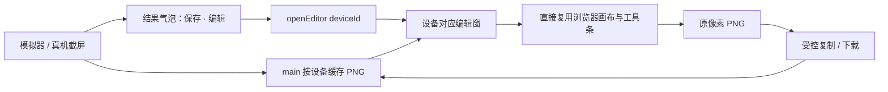
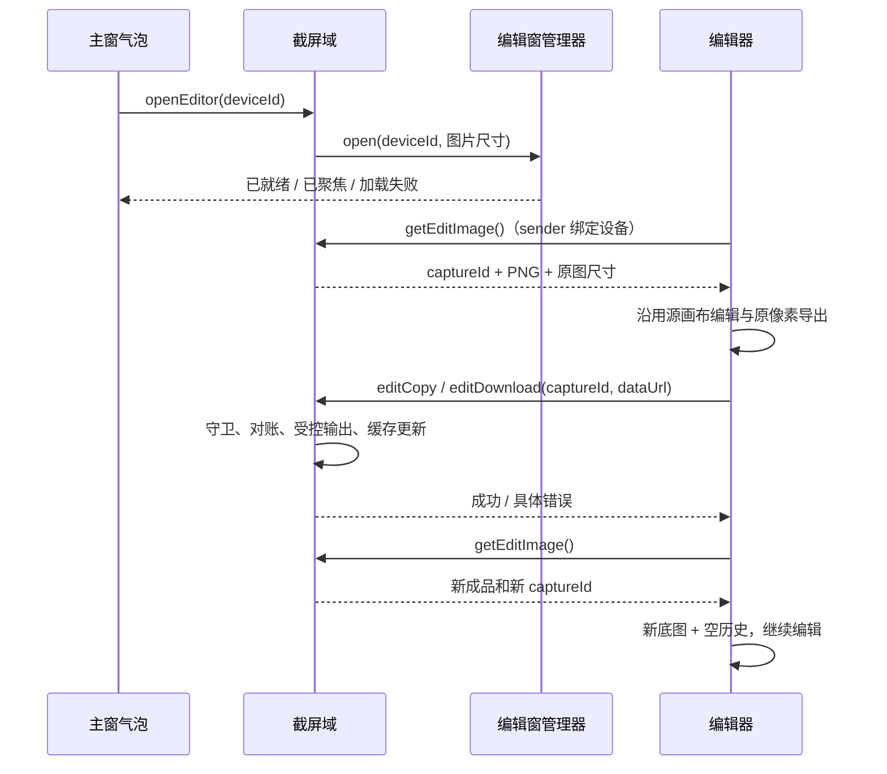

# 截图编辑器复刻 — plan

> 需求范围已确认，开发计划已编写，尚未实施。用户本轮要求创建计划，不开始编码。
> 批复依据：2026-11-02 用户确认[功能盘点](../notes/think-report/20261102145653-截图编辑器功能盘点.md)，并要求“尽可能按照多会话浏览器项目进行复刻”“能够复用的代码直接复用过来，没必要写不一样的”。
> 执行方式：按下面的任务及验证点顺序推进；阶段 5、6 的发现只记录，不顺手修复。

**目标：** 模拟器和真机截屏后，在现有结果气泡中提供“编辑”，打开与多会话浏览器尽量一致的图片编辑器，覆盖已确认的 20 项能力。

**架构：** 从 `D:/foreunit/bak/multi-session-browser` 直接迁入编辑器核心；本项目继续负责按设备的截图缓存、独立窗口、白名单 IPC、下载文件发布及主题语言。通过少量接缝适配接入，避免重新实现相同能力。

**技术：** 现有 Electron 39、React 19、TypeScript、styled-components、lucide-react、Vitest；新增与参考项目锁文件一致的 `konva@10.8.0`、`react-konva@19.2.7`，不引入其他 UI 框架或图片编辑器。

## Requirements brief

### Background

测试人员截取设备画面后，需要直接标注、打码、加文字、裁剪，再复制或保存，减少切换外部图片工具。浏览器项目已经有用户认可的编辑器，本功能优先搬运其实现和交互。

### Scope

- **Affects：** 截屏结果气泡及 hook、模拟器/真机共用工具条、截屏主进程域、编辑窗口、preload 截屏桥、共享契约、三语文案、编辑器局部样式、独立页面构建入口，以及相应测试和文档。
- **Does NOT affect：** ADB 截屏采集方式、投屏输入及解码、设备创建/配置/生命周期、录屏、日志、网络、剪贴板文本同步、SDK 配置；不重构这些模块，不重做主窗口或设置窗口标题栏。
- **Boundaries：** 输入来自本应用按设备缓存的 PNG；编辑器不读取任意本地文件、不维护图库、不持久化编辑草稿。输出为系统剪贴板 PNG 或系统下载目录 PNG；路径由 main 决定。设备停止/断开清缓存的现有约束继续有效。

### Requirement

全部纳入已确认的 20 项功能，具体行为见后文验收表。默认工具为矩形、颜色为红、粗细和字号为中、马赛克为框选模式，沿用源代码现值。

设计轴已结合项目现状裁定：图片数据归 main；编辑窗身份绑定设备；所有导出核对截图代次；下载沿用既有防覆盖发布；结果在编辑窗行内显示；主题与语言沿用跨窗同步；构建入口与索引同步更新。上述是本地接入设计，不新增产品能力。

## Impact range

### 现有接缝

| 文件 | 当前事实 | 本次改动 |
| --- | --- | --- |
| `src/main/screenshot/index.ts` | `Map<deviceId, CachedShot>` 保存每设备最近截图，停止时清理；capture 写剪贴板，save 写下载目录 | 为缓存增加 `captureId`，接入取图、复制、下载及开窗；复用现有落盘代码 |
| `src/main/ipc/index.ts` | 注入设备查询、主窗 sender 守卫，并在流生命周期清理截屏缓存 | 注入编辑窗口操作和 sender→deviceId 解析，不让截屏域反向依赖 devices/window |
| `src/main/window/settings.ts` | 已有异步就绪、加载超时、崩溃清理的窗口模式 | 用作本项目窗口生命周期先例，不修改设置窗 |
| `src/main/window/index.ts` | 主窗关闭时关闭各工具窗 | 补编辑窗清理 |
| `src/preload/api/screenshot.ts` | `window.api.screenshot.capture/save` | 追加四个编辑方法 |
| `src/preload/index.d.ts` | 从 `Api = typeof api` 派生 Window 类型 | 确认新增桥自然进入类型，不另造重复声明 |
| `src/renderer/src/hooks/useScreenshot.ts` | copied/saved 十秒收起，失败行内呈现 | 增加 `edit()` 和开窗忙态/错误归宿，保留现有截屏和保存状态机 |
| `src/renderer/src/components/ScreenshotPopover.tsx` | 缩略图、保存、关闭 | 成功态增加“编辑”，排在操作区最右侧 |
| `src/renderer/src/components/DeviceToolbar.tsx` | 模拟器/真机共用 | 传递 onEdit 及开窗忙态 |
| `src/renderer/src/components/DeviceCanvas.tsx`、`ExternalCanvas.tsx` | 分别使用同一 useScreenshot 和 DeviceToolbar | 两处接线，行为保持一致 |
| `electron.vite.config.ts` | 各工具窗独立 HTML 入口 | 添加 screenshotEditor 入口，主窗不静态引入 Konva |

### 影响图



### 风险

1. 源编辑器接的是全局单槽，本项目接的是设备缓存。不能直接搬全局 `lastCapture`，否则会串设备或破坏现有保存流程。
2. 源项目 `@ant-design/icons`、i18n hook、全局 CSS、角色 query 与本项目不同；只替换接缝，不借此重写编辑器。
3. 显示缩放、设备像素、系统 DPI 是三种尺度；沿用源图像坐标和导出 `pixelRatio=1/scale`，用真实 PNG 核验。
4. jsdom 无法证明 Konva 像素渲染正确；绘制、中文输入、马赛克和导出需要实际 Electron 窗口验证。
5. `windows-window-chrome` 是另一份独立计划；本功能只新增编辑工具窗，合并时读取其实际落地状态，不顺带实现或覆盖主窗/设置窗改动。

## Design

### 1. 复用纪律与源码基线

**优先级：直接复制现成代码 > 在复制代码上做必要适配 > 新写接入代码。禁止为了风格偏好另写一套相同功能。** 不抽通用图片编辑 SDK，不替换绘图库，不改算法，不增加与来源不同的工具或编辑方式。

源仓库基线：`1c5db74029796e6f73c96c65d66de0ff76e385ed`。计划编写时编辑器相关文件没有未提交差异；源仓库 `.gitignore` 的未提交改动与本功能无关，不复制。执行前复核下面四个文件；来源发生变化时先核对功能差异，不能把未审核的新行为混入。

| 源路径（相对 multi-session-browser） | 目标路径（相对本仓库） | 复用方式与允许差异 |
| --- | --- | --- |
| `src/renderer/src/components/browser/captureEditor/editorConstants.ts` | `src/renderer/src/components/ScreenshotEditor/editorConstants.ts` | 原样迁入类型、参数、几何函数；仅允许清理过时来源路径注释，不改执行逻辑 |
| `src/renderer/src/components/browser/captureEditor/AnnotationStage.tsx` | `src/renderer/src/components/ScreenshotEditor/AnnotationStage.tsx` | 直接迁入绘制、命中、拖动、文本 IME、裁剪、马赛克、导出代码；改 i18n import，必要的本仓库 lint/样式接缝 |
| `src/renderer/src/components/browser/captureEditor/EditorToolbar.tsx` | `src/renderer/src/components/ScreenshotEditor/EditorToolbar.tsx` | 保留 JSX 结构、工具顺序、条件设置、禁用及回调；将图标入口换 lucide、取词入口换本项目适配 |
| `src/renderer/src/components/browser/captureEditor/EditorWindow.tsx` | `src/renderer/src/components/ScreenshotEditor/index.tsx` | 保留 history、快捷键、绘制提交、导出和续编；替换 IPC、取词、错误归宿、根 Wrapper 与窗口标志 |
| `src/renderer/src/assets/app.css` 中完整截图编辑器段 | `ScreenshotEditor/index.tsx` 的唯一 styled Wrapper | 复制布局、尺寸、间距、交互态、棋盘底、裁剪按钮与文本框样式；限定在 Wrapper 中，替换主题变量接缝 |
| `src/main/browser/captureEditorWindow.ts` | `src/main/window/screenshotEditor.ts` | 复用图幅/工作区缩放算法、尺寸常量、正常工具窗行为；适配本项目独立 HTML、sandbox、图标、生命周期和设备归属 |
| `src/main/browser/capture.ts` 的编辑 PNG 校验与成品回写逻辑 | `src/main/screenshot/index.ts` | 复制 PNG data URL 校验和 captureId 对账逻辑，绑定本项目设备缓存；落盘复用本项目现有 writer |
| `src/shared/capture.ts` 中编辑接口类型 | `src/shared/screenshot-editor.ts` | 沿用 `CaptureEditImagePayload`、`CaptureEditApplyPayload` 结构和命名；通道仍登记到本项目 `IPC_CHANNELS` |
| `src/shared/i18n/locales/{zh-CN,zh-TW,en-US}/browser.ts` 的 captureEditor 文案 | `src/shared/i18n/screenshotEditor.ts` | 迁移既有三语文字，以本项目 Record 结构组织；新增设备相关错误才补文案 |

四个核心文件 SHA256：

```text
editorConstants.ts  760D634D6EBCC10C964876862300E694D75C0CF4694A29F3AE8CC2A01CF1CE16
AnnotationStage.tsx 38C8059AD8EA3832D3BB084D8A8A19D871224FDD43F40C51BCAD1D64BCB78918
EditorToolbar.tsx   C4201ADF87C06CA38E495B30B81DFFCFA38390706CEF2CDC5B739823FC70DEF1
EditorWindow.tsx    7B0EC6F1FF73F5FDBC2FCECAD773C46C2A87C9F90CE6BDC52FB37BF8A513881B
```

验收时逐文件对源代码 diff，差异应能归到本节“允许差异”。发现来源已有的问题只记 issue，不在复刻时顺手改算法。

### 2. 功能与交互对齐

| 清单编号 | 必须保留的行为 | 实现任务 / 验证 |
| --- | --- | --- |
| 1—4 | 矩形、椭圆、箭头、自由画笔，位次不变 | T4 / V1 |
| 5 | 马赛克框选和涂抹，默认框选 | T4 / V2 |
| 6 | 单行文字、中文 IME、Enter/失焦提交、双击再编辑、清空删除文字 | T4 / V3 |
| 7 | 裁剪遮罩、重新框选、确认/取消，保留范围内标注 | T4 / V4 |
| 8—11 | 六色；线宽 2/5/10；马赛克块径 10/18/28；字号 32/42/54 | T1、T4 / V1—V3 |
| 12 | 形状、文字、框选马赛克可移动；画笔及涂抹马赛克不可移动 | T4 / V1—V3 |
| 13—15 | 50 步全局历史、裁剪独立历史；Ctrl/Cmd+Z、Shift+Z、Esc；输入时文本撤销优先 | T4 / V4—V5 |
| 16—17 | 复制 PNG、下载 PNG，行内结果与错误反馈 | T2、T4 / V6 |
| 18 | 导出后不关窗，成品作新底图，清空标注和历史后续编 | T4 / V6 |
| 19 | 成功气泡最右侧“编辑”，独立工具窗、重复触发聚焦 | T3、T5 / V7 |
| 20 | 工作区约束的显示缩小，原图/裁剪像素导出 | T3、T4 / V8 |

保留源编辑器的限制：无图层面板、任意图片导入、旋转、翻转、滤镜、橡皮擦、通用单个标注删除、标注缩放/改色、手动缩放、图库及未保存关窗确认。裁剪中锁住其他工具，确认/取消/Esc 后回矩形。

### 3. 设备边界与缓存

本地必要适配限定如下：

- **缓存仍按设备。** `CachedShot` 新增随机 `captureId`；capture 与成功成品回写都换新 id。保留现有 `buffer/width/height/capturedAt/deviceName` 字段与停止清理路径。
- **窗口按设备单例。** 编辑窗口管理器 `Map<deviceId, WindowSession>`：同设备再次点编辑聚焦原窗、保留当前编辑；其他设备拥有自己的编辑窗，不抢占或悄悄切换原窗图片。它是源全局单例到本项目设备身份的必要映射，不增加窗口切换/图库界面。
- **图片读取绑定 sender。** 编辑窗开窗时在 main 登记设备 id；后续取图、导出由 sender 解析归属，不相信 renderer 自报的设备 id。query 仅传显示 scale/chrome，不能作为权限依据。
- **再截屏的过期行为按设备生效。** A 新截图令 A 旧编辑代次过期，A 导出显示截图已过期；B 截图不会使 A 过期。同设备重复打开只聚焦，不自动载入新图，沿用来源行为；关闭重开取本设备最新截图。
- **主窗选择设备不影响已开编辑窗。** 导出始终写回其绑定设备。设备停止/真机断开后窗口可保留当前画面，但缓存已清，后续新导出报过期，不重新访问设备或恢复缓存。
- **互斥沿用 captures/saves。** 同设备编辑复制/下载、原保存与截屏之间复用现有占位集合，冲突立即反馈 busy，不另建队列。下载期间停止清缓存时，落盘已成功的文件如实报告成功，缓存回写需比较原条目身份，不能复活已清的缓存。
- **文件命名保留两条已存在的规则。** 原“保存”继续按截图时刻命名；编辑窗“下载”沿用来源按保存时刻命名，将会话名换为截图来源设备名，仍使用本项目安全文件名及重名序号规则。
- **复制/下载后续编保留。** 成功成品更新本设备缓存并换新 id；编辑窗重新取图、烘焙为底图、清历史。若下载期间设备已停止，结果成功与后续取图失败分别显示，不能把已完成下载说成未保存。

### 4. 接口、权限和数据流

新增 `src/shared/screenshot-editor.ts`，编辑载荷直接迁入来源结构：

```ts
export interface CaptureEditImagePayload {
  captureId: string
  dataUrl: string
  width: number
  height: number
}

export interface CaptureEditApplyPayload {
  captureId: string
  dataUrl: string
}
```

`window.api.screenshot` 追加：

```ts
openEditor(id: string): Promise<void>
getEditImage(): Promise<CaptureEditImagePayload>
editCopy(payload: CaptureEditApplyPayload): Promise<void>
editDownload(payload: CaptureEditApplyPayload): Promise<ScreenshotSaveResult>
```

`ScreenshotSaveResult` 保留现有 `{ fileName: string }`；编辑器用该字段显示“已保存”。不为迁就来源的绝对 path 返回值改已有保存 API。原 `capture/save` 的签名和结果保持兼容，captureId 只在缓存及编辑接口内使用。

`IPC_CHANNELS` 追加：

| 常量 / 字符串 | 调用权限 | 主进程处理 |
| --- | --- | --- |
| `screenshotOpenEditor` / `screenshot:open-editor` | 仅主窗 | 校验 `{ id }`、读取该设备缓存尺寸、打开/聚焦该设备编辑窗，等待就绪 |
| `screenshotGetEditImage` / `screenshot:get-edit-image` | 仅已登记编辑窗 | sender→deviceId→该设备缓存；空缓存抛 screenshotStale |
| `screenshotEditCopy` / `screenshot:edit-copy` | 仅已登记编辑窗 | PNG 校验、代次对账、互斥检查、受控写系统剪贴板，更新本设备缓存 |
| `screenshotEditDownload` / `screenshot:edit-download` | 仅已登记编辑窗 | PNG 校验、代次对账、占位、下载发布、有效代次回写，返回 fileName |

`ScreenshotDeps` 增加 `openEditor(id, { imageWidth, imageHeight })` 与 `editorDeviceId(sender): string | null`；由 `src/main/ipc/index.ts` 注入窗口模块方法。截屏域不新增对窗口模块的反向 import。主窗不能调用编辑窗专属通道，其他工具窗也不能读取或提交截图。

输入护栏沿用来源：captureId 非空且不超过 128 字符；只接 `data:image/png;base64,`，总字符数不超过 30,000,000；解码后非空且宽高大于零。保留本项目采集 PNG 的 32 MiB 上限。非法入参在文件/剪贴板副作用之前拒绝，日志不打印图片 data URL。

落盘只使用 main 的系统下载目录。复用 `src/main/screenshot/index.ts` 现有“唯一临时文件 → link 原子占名 → 清理 part → EEXIST 重试”的实现；如需调用两次，只提取同文件私有 `writeShotToDownloads(cached)`，不另写 writer，不照搬来源的 rename 覆盖行为。



### 5. 界面、窗口和项目接缝

- **视觉依据：** 浏览器项目当前编辑器，而非新画稿。Impeccable 只用于适配/对照验收，不能借机改布局。保留约 48px 顶栏、28px 工具按钮、七工具顺序、设置区显隐、右上复制/下载、居中棋盘画布、裁剪操作条与行内反馈。
- **图标：** 本项目规范要求 lucide-react；仅将来源图标对应到 `Square/Circle/ArrowUpRight/Pencil/Blocks/Type/Scissors/Undo2/Redo2/Copy/Download`，保留尺寸、按钮形态和语义，不引入 Ant Design 依赖。
- **样式：** 原 CSS 段放到 `ScreenshotEditor/index.tsx` 的唯一 Wrapper，保留原 className 以减少迁移改动。用局部 `--chrome-*` 别名对接已有 `--board-bg/--board-hairline/--board-ink/--board-ink-dim/--board-hover-veil/--danger` 等 tokens；保留来源按压/选中透明度层级，在局部从现有墨色 token 派生。固定的六色标注、蒙版和像素化参数属于图像内容/绘制配置，不随主题变色。
- **取词：** 新增局部 `ScreenshotEditor/i18n.ts`，通过 `useCopy(SCREENSHOT_EDITOR_COPY)` 提供来源 `useT` 的窄适配，覆盖源编辑器实际使用的键及插值；它不是第二套 i18n 系统。原主窗“编辑”入口补入 `MAIN_COPY`；main 错误/窗标题补入 `ERRORS_COPY`。三语同步。
- **错误归宿：** 编辑器复制调用时统一改成 `toApiResult`，图像解码/画布异常由局部 try/catch 接住。沿用窗内错误条和 2.1 秒开始淡出、2.6 秒移除的成功反馈；不新增 toast、Notification 或确认弹层。
- **气泡：** copied 和 saved 态展示“编辑”，位于保存动作右侧；saving/capturing/error 不提供新编辑入口。开窗期间禁用编辑按钮，开窗失败复用气泡错误反馈。十秒自动收起与设备切换收起沿用现有 hook。
- **独立入口：** 新增 `src/renderer/screenshot-editor.html`、`src/renderer/src/screenshot-editor/index.tsx`；参照 settings 入口包裹 `DeviceThemeProvider` 并加载 global.css。CSP 沿用本地页面约束，放行截图 `data:` 图片，不新增远端网络权限。
- **窗口：** 新增 `openScreenshotEditorWindow`、`screenshotEditorDeviceId`、`closeAllScreenshotEditorWindows`。直接迁移来源尺寸算法与度量常量；用本项目 `appIcon/themeWindowBackground`、`sandbox:true`、独立 HTML、禁止新窗口及主窗关闭清理。加载就绪/15 秒超时/崩溃/单例释放参照 settings 窗，避免只复制来源的静默加载失败。Windows 使用本编辑窗自身原生框；macOS 采用本项目已用的 hiddenInset 和原生三灯，保持顶栏让位与可最小化/全屏。其他窗口外观不变。

### 6. 新增文件清单

```text
src/shared/screenshot-editor.ts
src/shared/i18n/screenshotEditor.ts
src/main/window/screenshotEditor.ts
src/renderer/screenshot-editor.html
src/renderer/src/screenshot-editor/index.tsx
src/renderer/src/components/ScreenshotEditor/index.tsx
src/renderer/src/components/ScreenshotEditor/EditorToolbar.tsx
src/renderer/src/components/ScreenshotEditor/AnnotationStage.tsx
src/renderer/src/components/ScreenshotEditor/editorConstants.ts
src/renderer/src/components/ScreenshotEditor/i18n.ts
src/main/window/__tests__/screenshotEditor.test.ts
src/renderer/src/components/ScreenshotEditor/__tests__/editorConstants.test.ts
src/renderer/src/components/ScreenshotEditor/__tests__/EditorToolbar.test.tsx
src/renderer/src/components/ScreenshotEditor/__tests__/index.test.tsx
book/docs/decisions/ADR-005-screenshot-editor-reuse.md
book/docs/poc/2026-11-02-screenshot-editor.md
book/notes/summary/2026-11/2026-11-02-截图编辑器.md
```

ADR 编号和验收/summary 日期在真正实施时按已有文件检查冲突及实际完成日调整；不覆盖其他任务文档。新增 learn/issue 按实际发现建在对应月份，无发现不凑记录。

## Build order

### 阶段进度

- [x] Step 0：完整简报，20 项及复刻方向由用户确认。
- [x] 阶段 1：已读取两项目的画布、工具条、窗口、缓存、IPC、构建与语言主题接缝。
- [x] 阶段 2：复用映射、接口、设备边界、权限、反馈及测试方案写入本计划。
- [ ] 阶段 3：执行 T1—T5；每项先补能验证接缝的失败测试，再迁入最少代码。
- [ ] 阶段 4：执行 T6、V1—V9 并跑完整门禁。
- [ ] 阶段 5：执行 T7，只记录评审发现。
- [ ] 阶段 6：执行 T8，只记录收尾发现、回写文档和索引。

### T1. 固定复用基线与契约

**文件：** 上述共享契约、字典、editorConstants；修改 `src/shared/ipc-channels.ts`、`src/shared/i18n/index.ts`、`mainWindow.ts`、`errors.ts`、`package.json`、`package-lock.json`、PRD 4.1；新增 ADR。

- [ ] 核对源仓库提交和四文件 hash，记录复制来源。直接复制 `editorConstants.ts`；为其写裁剪坐标用例：rect/text/ellipse/arrow/brush/mosaicBrush 平移、马赛克夹紧、越界裁剪至少 1px。
- [ ] 定义本计划四个编辑桥方法及通道，迁移三语字典，使用现有 `satisfies`/Record 模式约束完整性；新增 i18n 字典时扩展 `src/shared/__tests__/i18n.test.ts` 的覆盖。
- [ ] 在 PRD 4.1 和 ADR 记录：Konva/react-konva 是直接复用源编辑器的绘图依赖，不替换现有 UI 栈；列出图标、窗口、缓存和文件发布的必要差异。
- [ ] `npm install --save-exact konva@10.8.0 react-konva@19.2.7`。复制源版本而非择新版本；不引入仅供 Node 画布的 canvas/skia-canvas，不改 Electron/React 主版本。
- [ ] 运行下面命令；预期新增几何/三语测试和 typecheck 通过。

```powershell
npm run test -- src/renderer/src/components/ScreenshotEditor/__tests__/editorConstants.test.ts src/shared/__tests__/i18n.test.ts
npm run typecheck
```

### T2. 截屏缓存、编辑 IPC 与复用下载发布

**文件：** 修改 `src/main/screenshot/index.ts`、`src/main/screenshot/__tests__/index.test.ts`、`src/preload/api/screenshot.ts`。

- [ ] 先扩展现有 handler harness，分别模拟 main、设备 A 编辑窗、设备 B 编辑窗和未知 sender；新增失败用例覆盖身份、空槽、过期 id、错设备、非法 PNG、字符上限和下载失败。
- [ ] `CachedShot` 增加 captureId，在 capture 入缓存时分配；不改变旧 capture 返回结构、不改 ADB runner。
- [ ] 从浏览器 `capture.ts` 复制编辑入参校验/对账与写剪贴板逻辑；将全局槽引用换为 sender 绑定设备的缓存，生成成品新 id 和宽高。
- [ ] 同文件提取现有 `writeShotToDownloads(cached)` 供原 save 和 editDownload 共用，保留 hard-link 防覆盖与错误清理。用 `saves/captures` 占位及条目比较防止并发回写复活缓存。
- [ ] 补 preload 四方法。验证错误路径既无剪贴板写入也无正式文件；失败不换 captureId；成功只更新归属设备。下载成功而设备清缓存的情况不得回填。
- [ ] 跑指定测试；原 capture/save、跨设备同名占名和停止时迟到结果测试继续通过。

```powershell
npm run test -- src/main/screenshot/__tests__/index.test.ts
npm run typecheck
```

### T3. 独立窗口与构建入口

**文件：** 新增窗口及入口文件和窗口测试；修改 `src/main/ipc/index.ts`、`src/main/window/index.ts`、`electron.vite.config.ts`。

- [ ] 先写窗口测试：同设备重复打开只构造一次、不同设备不同窗口；就绪后显示；超时/加载失败/崩溃可重新打开；迟到旧事件不清理新窗口；sender 归属正确；关闭主窗清空全部编辑窗。
- [ ] 从来源窗口复制尺寸算法和常量，参照本项目 settings 生命周期登记设备单例。图像缩放只通过 query 传显示值，权限从窗口登记表读取。
- [ ] 独立 HTML 与 React 入口先接好真实取图，再接 T4 的迁入编辑器；Vite 增加入口。main 保持 sandbox 与本地页面加载路径。
- [ ] 注入 `openEditor/editorDeviceId`；主窗关闭时关闭所有编辑窗。不要把工具窗挂到当前选中设备变化回调上。
- [ ] 跑窗口测试；构建确认 `out/renderer/screenshot-editor.html` 及其引用产物存在，主窗入口不静态 import 编辑器。

```powershell
npm run test -- src/main/window/__tests__/screenshotEditor.test.ts
npm run build
```

### T4. 搬运编辑器界面与画布

**文件：** 新增 `components/ScreenshotEditor/` 的剩余文件及三个同置测试；不修改投屏画布。

- [ ] 对照源代码直接复制 AnnotationStage、EditorToolbar、EditorWindow 到复用映射的目标路径；不先手写同功能组件。拷贝编辑器完整 CSS 段而非零散重画。
- [ ] 写 EditorToolbar 行为测试：七工具顺序、马赛克模式及块径、颜色和字号显隐、裁剪锁定、撤销/重做禁用态与回调。
- [ ] 写窗根测试：mock 绘制边界与白名单 API，核验载入失败、旧 id 导出失败保留编辑态、成功换图清历史、复制后继续下载、busy 防重复、卸载定时器清理。不得用 mock 测试声称像素效果正确。
- [ ] 仅替换项目接缝：useT 窄适配、lucide 图标、Wrapper 样式和 tokens、`window.api.capture`→`window.api.screenshot`、`toApiResult`、`fileName`。保持源 snapshot、crop、draw 和 IME 路径。
- [ ] 按源逻辑完成原像素导出、行内成功反馈与成品续编；分别呈现输出成功和随后取图失败，避免下载已落盘却被误报为未保存。
- [ ] 与四份源文件逐项 diff，记录所有执行逻辑差异的本地接缝理由。跑以下自动测试，再到 T6 验证真实画布。

```powershell
npm run test -- src/renderer/src/components/ScreenshotEditor
npm run typecheck
```

### T5. 截图气泡入口与双设备画布接线

**文件：** 修改 `useScreenshot.ts`、ScreenshotPopover、DeviceToolbar、DeviceCanvas、ExternalCanvas 及其已有测试。

- [ ] 先补 hook、气泡、工具条测试：copied/saved 可编辑，saving/error 无入口，点击调用当前设备 openEditor；加载中禁用重复点击；开窗失败有错误归宿。
- [ ] 给 hook 增加 `edit()` 与独立开窗 busy，不另造截屏状态机；用 `toApiResult` 包装，忽略设备切换/组件失效后的迟到回填。
- [ ] 传 `onScreenshotEdit` 与忙态；成功气泡并排排列保存/编辑，saved 态保留编辑。保留原缩略图、关闭、保存和十秒自动收起。
- [ ] 两处画布都接 `shot.edit()`；真机保持截图与投屏 disabled 独立的现有规则。
- [ ] 跑 hook、气泡、工具条及画布相关用例；确认打开编辑器没有再次发起 adb 截屏。

```powershell
npm run test -- src/renderer/src/hooks/__tests__/useScreenshot.test.tsx src/renderer/src/components/__tests__/ScreenshotPopover.test.tsx src/renderer/src/components/__tests__/DeviceToolbar.test.tsx
npm run typecheck
```

### T6. 功能与复刻验收

- [ ] 逐条执行下文 V1—V9，把输入图片、实际操作、输出 PNG 尺寸及截图证据写入 `book/docs/poc/<实际日期>-screenshot-editor.md`。
- [ ] 使用相同测试图片在来源与目标编辑器对照：矩形、箭头、文字、两种马赛克、裁剪、历史与复制/下载；以实际图和操作结果核对，不能只对照源码注释。
- [ ] 在本机实际支持的设备与平台完成验证。无法实测的平台、原生窗控或真机路径写清未验项，不用 jsdom 或单个平台结果替代。
- [ ] 运行全部门禁，保存摘要。失败在阶段 3/4 内处理并重新跑相关验证；进入阶段 5 后只记录。

```powershell
npm run typecheck
npm run lint
npm run test
npm run build
npm run book:index
```

### T7. 阶段 5 代码评审

- [ ] 按 `book/guidelines/review-checklist.md` 对 diff 检查：范围、复用差异、sender 归属、过期、停止清理、并发、文件防覆盖、通知和生成入口。
- [ ] 验证 20 项均对应任务与实测证据；核对没有替换源算法、引入另一套历史/绘图库、搬入浏览器会话管理或错误态假成功。
- [ ] 发现写入 `book/notes/issue/<月份>/`，只记录不改代码。有影响交付的问题保留未完成状态，并另行安排修复轮，不把本计划标 completed。

### T8. 阶段 6 收尾

- [ ] 按 book-writeback 和 BoWrite 写功能报告：背景、做了什么、复用哪些源码、为何保留来源行为、验证结果及后续；明确必要适配及未验范围。
- [ ] 有实际经验写 learn，有遗留问题写 issue，不凑条目；相关 PRD/ADR 与实际实现一致，不另起 changelog。
- [ ] 核对 Done criteria 后把本计划翻 completed；若存在对应阶段项，仅在实际满足后勾选并附结果，不改历史功能报告来代替任务状态。
- [ ] 新增月份目录时补 `scripts/gen-book-index.mjs` 用途表；运行 `npm run book:index` 和 `npm run book:release-check`，零断链、索引新鲜。收尾发现只记录。

## Test plan

| 用例组 | 操作与明确预期 |
| --- | --- |
| V1 形状与画笔 | 六色、三档线宽各绘制代表标注；拖动形状后导出位置一致，画笔笔迹不响应拖动 |
| V2 马赛克 | 框选与涂抹在细字/头像测试图上分别测试三档；对照来源的块径和路径；框选可移动，涂抹不可移动；检查导出实际打码结果 |
| V3 文字 | 中文组合输入不提前提交，Enter/失焦只提交一次；双击修改，清空删除；三档字号及六色一致，换行按单行处理 |
| V4 裁剪 | 进入即蒙版，框选时实时镂空；重框可撤销/重做；确认后尺寸与选区一致、标注平移正确；取消/Esc/确认回矩形；全局撤销恢复已确认裁剪 |
| V5 历史 | 新建/移动/文字/裁剪均可撤回和重做；51 次操作验证 50 步上限；新动作清空 future；文本聚焦时 Ctrl/Cmd+Z 不改画布历史 |
| V6 成品 | 复制后可粘贴真实 PNG，下载文件可打开；复制→下载不误报过期；导出后旧标注合成、撤销不可回到导出前；继续新标注正常；下载失败不清历史、不换缓存 |
| V7 入口与归属 | 模拟器/真机 copied/saved 态有入口，失败态无入口；重复点同设备聚焦；A/B 窗口、PNG、剪贴板及缓存不混用；切选中设备不换编辑图；同设备新截图/停止后旧导出报过期 |
| V8 尺寸与视觉 | 同一张竖屏、横屏、小图、大图分别对照；显示只缩不放，导出 PNG 像素恢复原图/裁剪尺寸；亮暗/三主题/三语无缺词及控件遮挡；Windows 100%/150% DPI、macOS Retina 在可用环境实测并记录 |
| V9 权限与失败 | main/未知窗调用编辑专属通道拒绝；伪造 id、非 PNG、空图、超长 data URL、旧 captureId、下载不可写无越权副作用；窗口超时/崩溃可重开；停止发生在下载期间不会复活缓存 |

源码级对照只检查复用边界；最终截图与导出检查才证明编辑效果。不开快照测试来锁死整份 JSX，也不为纯复制的常量逐值写镜像断言。

## Done criteria

- [ ] 20 项能力全部实现，来源限制及导出烘焙清历史行为保留。
- [ ] 四核心文件经过来源 diff；每处差异都有本计划允许的项目适配理由，未重写已有工具与算法。
- [ ] 模拟器和真机均有编辑入口，按设备缓存及窗口身份隔离，过期与停止不串图、不恢复旧缓存。
- [ ] 真实编辑器完成工具、中文输入、马赛克、裁剪、撤销/重做、复制/下载及原像素 PNG 验证；来源对照证据与未验边界记录清楚。
- [ ] 既有截屏入剪贴板、原保存、重名防覆盖、气泡关闭/收起及设备切换回归通过。
- [ ] typecheck、lint、test、build 全绿，独立入口可构建加载；PRD、ADR 与新增依赖对齐。
- [ ] 阶段 5/6 发现只记录；无未处理的交付阻塞；功能报告与必要 learn/issue 已写，索引及 release-check 通过。
